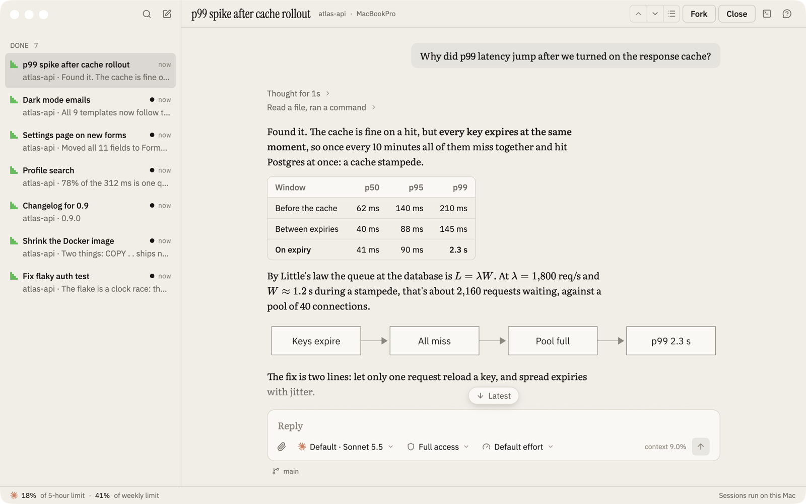
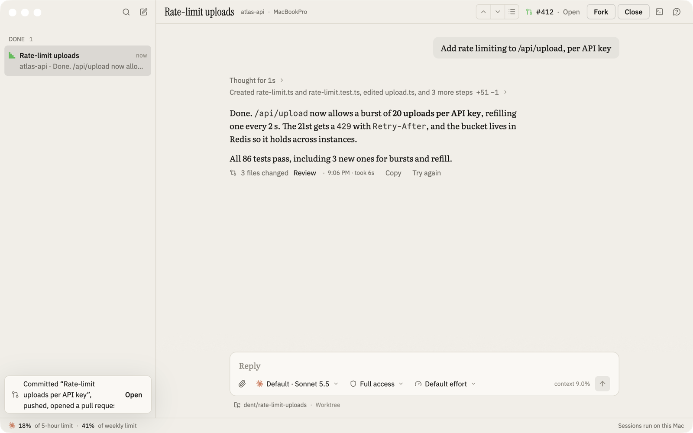
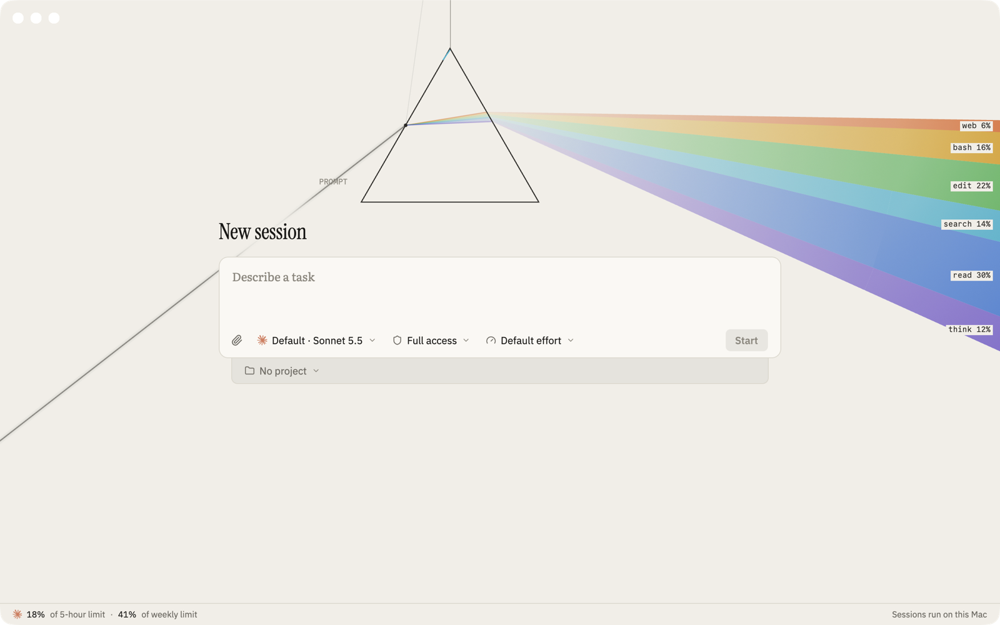

<h1 align="center">dent</h1>

<p align="center">
  A fast, chat-first app for driving coding agents on any machine you own,<br>
  from a native desktop app or your phone.
</p>

<p align="center">
  <a href="https://github.com/SarimDEV/dent/actions/workflows/ci.yml"></a>
  <a href="https://github.com/SarimDEV/dent/releases"></a>
  <a href="LICENSE"></a>
</p>

<picture>
  <source media="(prefers-color-scheme: dark)" srcset="docs/media/hero-dark.png">
  
</picture>

Agents run under a small daemon on each machine, so sessions survive closed lids, dropped connections and restarts. Clients are just views: close the app, open it tomorrow, and every session is where you left it.

## What it does today

- **Chat that keeps up.** Replies stream in as rich text: tables, maths, diagrams and highlighted code, smooth even in long sessions.
- **Answer in place.** Approvals and questions appear in the chat. Queue your next message or steer the current one, and Stop stops.
- **Sessions that outlive the app.** Quit dent, restart the daemon, reboot: nothing is lost.
- **Worktrees and Git built in.** Start a task in its own worktree, then commit, push and open the pull request from the header.
- **What the agent makes opens beside the chat.** Files, pictures and pages, without leaving the session.
- **Your own Claude Code.** dent drives the `claude` you already have, signed in as you, and shows your usage limits as you go.

<p>
  <picture>
    <source media="(prefers-color-scheme: dark)" srcset="docs/media/ship-dark.png">
    
  </picture>
  <picture>
    <source media="(prefers-color-scheme: dark)" srcset="docs/media/ambient-dark.png">
    
  </picture>
</p>

## Where it's going

dent is early and moving fast. The desktop app runs on macOS today. Next up:

- [ ] Machines: drive agents on your other computers over Tailscale or your LAN (in progress)
- [ ] Codex alongside Claude Code
- [ ] The iPhone app, with approvals from the lock screen
- [ ] Linux and Windows

The [roadmap issue](https://github.com/SarimDEV/dent/issues?q=is%3Aissue+label%3Aroadmap) tracks what's next, and [docs/build-order.md](docs/build-order.md) has the full plan.

## Try it

**Download:** grab `dent.app` from the [latest release](https://github.com/SarimDEV/dent/releases) (Apple silicon, macOS 13 or later). Builds aren't notarised yet, so the first time, right-click the app and choose **Open**.

**Build from source** (needs [Rust](https://rustup.rs)):

```sh
git clone https://github.com/SarimDEV/dent && cd dent
scripts/bundle.sh --install      # builds dent.app with its daemon and installs it in ~/Applications
open ~/Applications/dent.app
```

dent needs [Claude Code](https://docs.anthropic.com/en/docs/claude-code) installed and signed in. It uses your Claude limits the same way the terminal does. To try it without touching your account, `scripts/walk.sh checks` runs the app against a stand-in agent in a scratch home.

## How it fits together

```
desktop · iphone · web · cli        views with a cache
        │  one versioned protocol, direct over Tailscale or the LAN
        ▼
daemon (one per machine)             owns sessions; append-only event log
        │
        ▼
agents (Claude Code, Codex next)     each behind one Driver trait
```

It's written in Rust, with [GPUI](https://www.gpui.rs) for the desktop app. [docs/](docs/README.md) has the spec, the architecture and every design decision.

## Contributing

Bug reports, ideas and pull requests are welcome. See [CONTRIBUTING.md](CONTRIBUTING.md) to get set up, and please report security issues privately as described in [SECURITY.md](SECURITY.md).

## License

MIT, except [`crates/hub`](crates/hub), which is AGPL-3.0.
