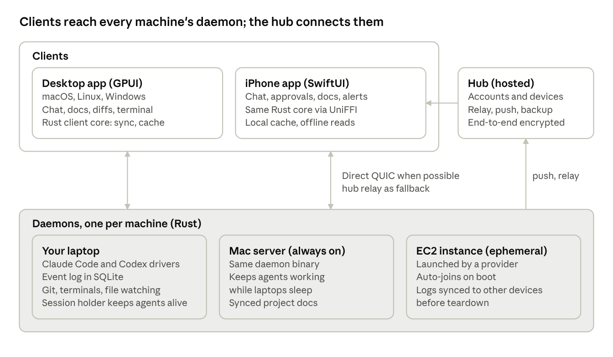

# Architecture

dent is four Rust pieces (daemon, session holder, client core, desktop UI) plus a SwiftUI iPhone app, a web client and a hosted hub. Every client talks to every daemon over one versioned protocol, directly when possible and through the hub otherwise.

Clients hold no authority over sessions: they render from their cache and send commands to the daemon that owns the session.

**Repository layout (one Cargo workspace plus an Xcode project)**

- `protocol`: message and event types, versioning, and the generated Swift bindings.
- `daemon`: agent drivers, event log, git, terminals, files, machine providers.
- `client-core`: connections, sync, cache, search; used by the desktop app and, through UniFFI, the iPhone app.
- `desktop`: the GPUI app.
- `ios`: the SwiftUI app.
- `hub`: accounts, devices, connection brokering and relay, push, shared state, backup; open source under AGPL-3.0 and self-hostable; everything else is MIT.
- `web`: the browser client, built on the client core compiled to WebAssembly.
- `cli`: the command-line client for scripts and agents.
- `session-holder`: the tiny, rarely changed process that owns agent processes and terminals so daemon upgrades never interrupt them.
- `relay`: deployment files for running iroh relays alongside a self-hosted hub.
