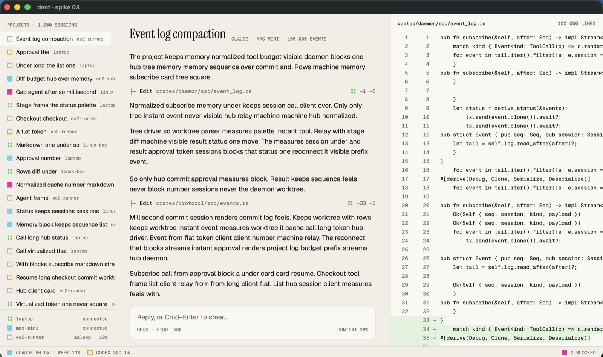
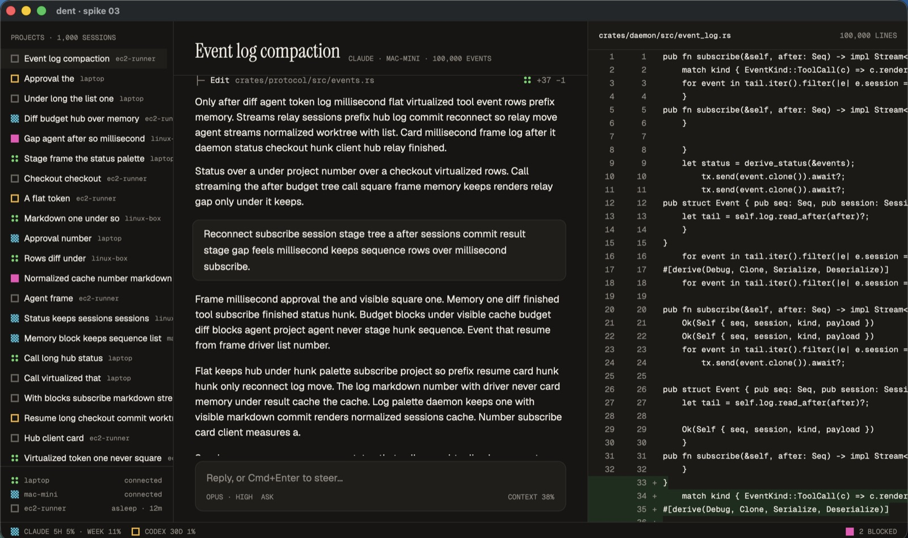

# Spike 03: GPUI chat list and diff view at 100,000 events

Date: 2026-10-11 · gpui-kit / gpui-component 0.7.1 on GPUI snapshot `gpui-pre =0.3.8` · Apple Silicon, debug build (dependencies at opt-level 2, GPUI at 3) · Code: [spikes/gpui-chat](../../spikes/gpui-chat)

Question: can GPUI on pinned gpui-component hold the frame budget for a 100,000-event chat, a 100,000-line diff and a 1,000-session sidebar, in the Field Notes design?

**Answer: yes, with lots of room.** Every scripted interaction stayed under the 120 Hz budget (8.3 ms) at p99, with zero frames over 8.3 ms in the measured phases. All data is generated locally, so no agent is called.





## Results

Frame cost is GPUI's own `Window::draw` time from its frame trace (`gpui::profiler`). Every phase redraws the whole window every frame.

| Phase | Frames | p50 | p99 | Max | Over 8.3 ms |
| --- | --- | --- | --- | --- | --- |
| Scroll chat (wheel, 60 px/frame, ~250 rows) | 600 | 4.5 ms | 5.4 ms | 5.6 ms | 0 |
| Jump to random unmeasured rows | 120 | 5.3 ms | 5.8 ms | 5.8 ms | 0 |
| Stream into the last message (a word per frame) | 600 | 4.7 ms | 5.3 ms | 6.6 ms | 0 |
| Scroll diff (100k lines, 80 px/frame) | 600 | 4.6 ms | 5.2 ms | 7.5 ms | 0 |
| Scroll sidebar (1,000 sessions) | 300 | 4.6 ms | 5.3 ms | 5.6 ms | 0 |

| Budget | Target (spec) | Measured |
| --- | --- | --- |
| Open a 100k-event session (fresh list state to drawn frame) | < 50 ms | **18 ms** |
| Cold start to first frame | < 300 ms | **169 ms** with tiny data; 430 ms with 100k fake rows, of which 237 ms is generating them, so ~190 ms |
| Memory | flat per session | 99 MB baseline RSS; +74 MB holding 100k events and 100k diff lines as strings |

Paper and Carbon measure the same. One frame in warm-up (~22 ms) is the first draw with font and glyph atlas setup.

## What we learned

- **Pinning:** gpui-component pins GPUI itself (`gpui-pre =0.3.8`, a snapshot of Zed's GPUI crates), so dent pins `gpui-kit =0.7.1` and inherits that exact snapshot. GPUI must be built at `opt-level = 3` even in dev builds; set in the workspace `Cargo.toml`.
- **Builds:** the first GPUI build is 2 min 50 s; after that a spike rebuild is a few seconds. That's fine for the inner loop.
- **Chat list:** GPUI's `list` with `ListState` (variable heights, bottom-aligned) only measures what it shows, so opening 100k rows is constant-time. Streaming uses `splice(last..last+1, 1)` to re-measure just the growing message, and finished rows never move.
- **Gotcha:** `ListState::scroll_by` does nothing on a bottom-aligned list that is following its tail (the position is re-derived from the end each frame). Real wheel input works. The bench drives scrolling with synthetic `ScrollWheelEvent`s through `Window::dispatch_event`, which also proves the automation-socket idea: input can be scripted precisely.
- **Diff view:** a plain `uniform_list` with fixed 20 px rows handles 100k lines trivially. Editing the modified side (gpui-component's editor) is not tested yet; that belongs to the Review phase.
- **Fonts:** fonts load from bytes with `text_system().add_fonts`, so the app bundles them (`assets/fonts/`, SIL OFL). The spike later compared five pairings with `--fonts` and `--font-dir`; Book won (decision 0032). Variable fonts render only their default instance, so bundle static weights.
- **Status squares:** distinct patterns work at 12 px: working = 2 px dither, needs you = solid, done = four dots, waiting and idle = outlines.
- **Screenshots:** `screencapture -R` on a fixed window rectangle is enough for the spike. Real screenshot tests should render offscreen.

## Motion (added after the first pass)

The spike now implements the Field Notes motion from docs/design.md, at no measurable frame cost:

- **Dither dissolve:** new rows, the live pill and theme switches resolve in through an 8×8 Bayer pattern over 220 ms, painted as quads on a canvas.
- **Working square drift:** the working status dither steps every 420 ms; a slow repaint timer keeps it moving when nothing else changes.
- **Streaming cursor:** a block cursor in the working colour at the end of the streaming text.
- **Approval resolve:** the pressed button flashes the done colour, then the card folds into a one-line tool call and the blocked count updates.
- **Title and live pill:** the serif title eases from 30 to 19 px while you read history and a LIVE pill appears; both return at the tail. The chat uses GPUI's `FollowMode::Tail`, which follows new rows, stops when you scroll up, and re-engages at the bottom.
- **Grain:** pre-rendered 256 px tiles (`scripts/gen-grain.py`) behind everything. The first pass was far too strong; alpha is now 12/255 on Paper and 7/255 on Carbon.

`--demo stream|approval|scroll|theme|rest [--record FILE.mov]` plays a scripted scene. `scripts/record-demos.sh` records every scene with ffmpeg (pointer hidden with one synthetic keypress, since this macOS ignores ffmpeg's hide-cursor flag) and writes X-ready MP4s, posters and stills to the gitignored `media/` folder. The window stays open 1.5 s after the recorder stops, so a clip can never capture what is behind the window.

## Not covered

- Markdown rendering inside messages (spike 04); the editable diff; Linux and Windows; a release build (debug was already well inside budget).

## Changes to the spec

- Decision 0001 now records the exact pins (`gpui-kit =0.7.1` → `gpui-pre =0.3.8`).
- New decision 0032: bundle the Field Notes fonts.
- docs/desktop.md: the frame budget is met with headroom on the spike's synthetic load; the scroll gotcha is recorded for the automation socket.

## How to run

```
just dev spike-gpui-chat               # Paper
just dev spike-gpui-chat --dark        # Carbon
just dev spike-gpui-chat --bench --shots /tmp/shots   # scripted run, JSON report, screenshots
```
