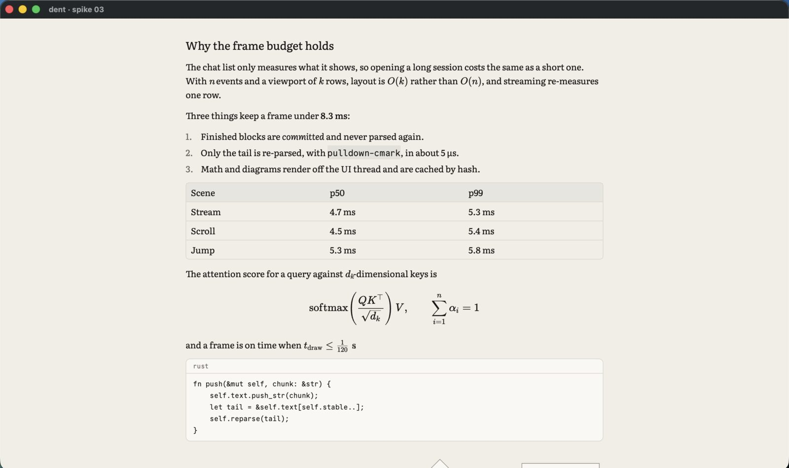
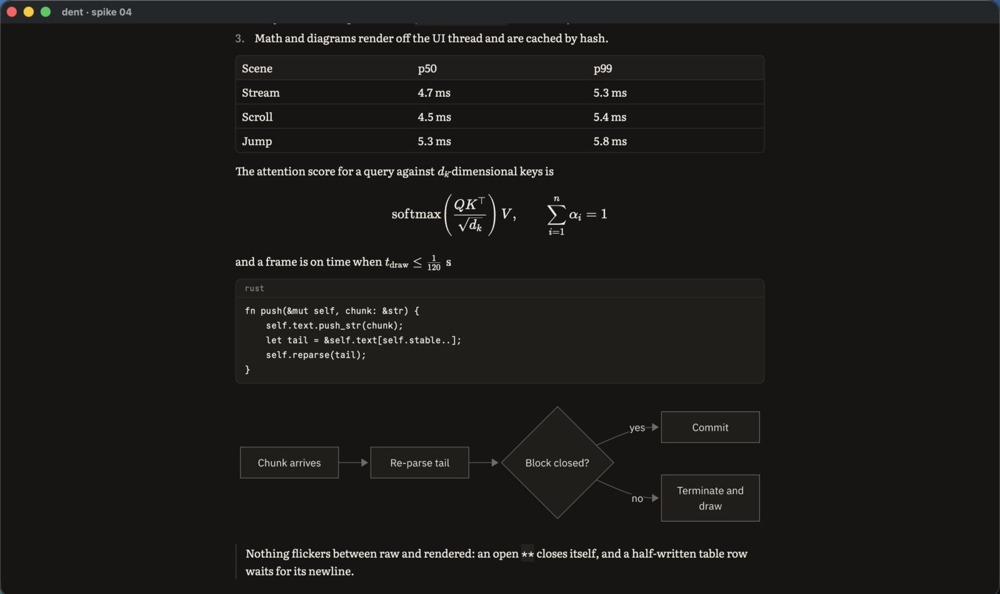
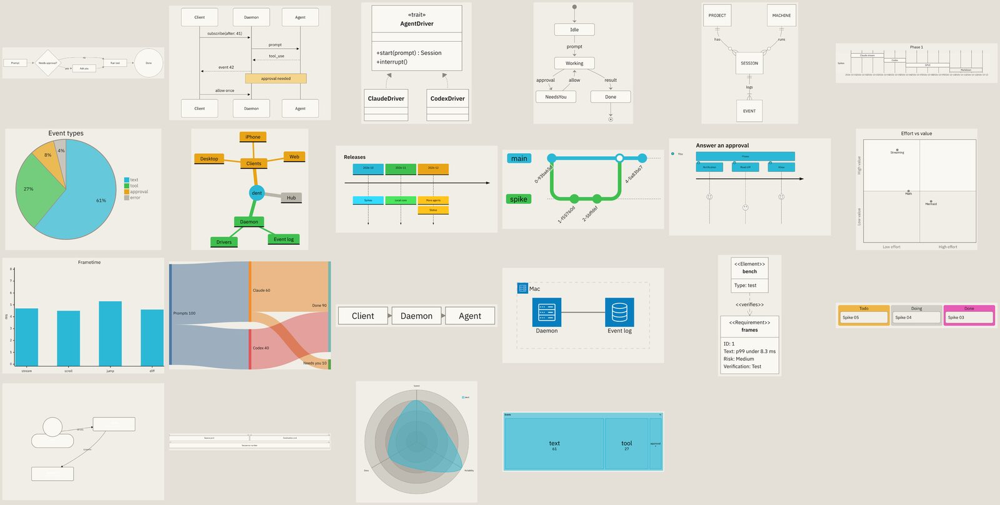

# Spike 04: RaTeX, merman and streaming Markdown against real transcripts

Date: 2026-10-11 · pulldown-cmark 0.13.4, RaTeX 0.1.14, merman 0.8.0, resvg 0.46.0 · Apple Silicon, release build for the headless runs, debug build for GPUI · Code: [spikes/markdown](../../spikes/markdown) (headless, a library and a CLI) and `--specimen` in [spikes/gpui-chat](../../spikes/gpui-chat)

Questions:

- Can a stable-prefix layer over pulldown-cmark stream real agent output with finished blocks never moving and nothing flickering?
- Does RaTeX typeset what agents write, and can GPUI draw it natively?
- Does merman render Mermaid headless, in Field Notes, fast enough?

**Answer: yes to all three, with three rules the spec now records.**

- `$…$` is maths only when it looks like TeX.
- Tight and loose lists render the same.
- Glyphs from KaTeX's Size fonts are drawn from their outlines, because GPUI won't load those fonts.

No script engine or web view is needed for maths or diagrams.

The corpus is every assistant message in the local Claude Code and Codex transcripts on the development Mac: 16,114 messages (15,877 Claude Code, 237 Codex), 6.7 MB of text. They were read in place. Only counts and timings were kept; no transcript text is in this repo.





## Streaming

Each message is replayed in chunks and three things are checked after every chunk:

- Committed blocks never change.
- The final result equals a one-shot parse.
- What a reader sees only grows. Text never changes style or block and never vanishes. This is checked as characters tagged with style and block kind, each frame a prefix of the final.

| Replay | Steps | Committed block changed | Final ≠ one-shot | Messages that flicker |
| --- | --- | --- | --- | --- |
| No terminator, 1–12 byte chunks | 1,037,833 | 0 | 0 | 31.8% |
| Terminator, 1–12 byte chunks | 1,037,833 | 0 | 0 | **0.23%** (0.18% of steps) |
| Terminator, every byte | 6,658,815 | 0 | 0 | **0.25%** (0.18% of steps) |

The ~37 messages that still flicker are genuinely ambiguous: a `**` that the rest of the message never closes, an escaped backtick inside a code span, a code span with a leading space. Each flicker lasts a few chunks.

| Cost | p50 | p99 | Worst |
| --- | --- | --- | --- |
| One push (re-parse tail, terminate, re-split) | 5 µs | 62 µs | single outliers vary run to run, up to a few ms |
| A 100 KB code block still streaming | 0.07 ms | | 0.4 ms |
| A 2,000-row table still streaming | 1.3 ms | | 2.6 ms per push at the end, 4.8 ms max |
| A 50 KB single paragraph still streaming | 0.7 ms | | 2.2 ms |

How the layer works:

- **Commit rule:** every top-level block is committed once the line that starts the next block is complete. Committing as soon as a next block merely exists was wrong: a half-typed `2` before `2.` parses as a paragraph, which ended the list above it (138,620 broken steps before this fix).
- **Terminator:** the unfinished tail is rewritten before parsing.
  - It closes open `**`, `*`, `_`, `~~`, code spans (matching backtick run length) and links, following CommonMark's flanking rules.
  - It drops delimiters that have no content yet, and spaces before an auto-closer.
  - It holds back text whose meaning is still unknown: an unclosed `$` or an unresolved `[`.
  - It holds back an ambiguous last line: a fence, table row or `$$` being typed, a bare list or heading marker, a setext underline, or a lone number. It re-checks after holding text back, because hiding `[` can leave `- ` under a line, which would make that line a heading.
- **Cost:** a huge block that stays the tail is re-parsed in full on every chunk. Clients batch the chunks that arrive within a frame into one push, and parse off the UI thread; a row-level commit for long tables can come later if needed.

## Maths

- **Dollar signs:** every one of the 74 `$…$` spans pulldown-cmark found in the corpus was two prices (`$10/mo ($30/mo`), not maths. RaTeX happily "typesets" them, so a failed typeset can't be the guard. Rule: a single-dollar span that starts with a digit or space and contains none of `\ ^ _ {` stays text. After it, one span in the corpus is maths. `$$…$$` is unaffected. No display maths or `\(…\)` appeared in the corpus.
- **Coverage:** RaTeX typeset all 40 fixtures:
  - fractions, roots and big operators with limits;
  - matrices, `aligned`, `cases`, `array` and `gather`;
  - accents, `\left…\right`, `\boxed`, colour, `\xrightarrow`, `\tag`;
  - `\ce` chemistry and `\href`.
- **Speed:** p50 67 µs per formula. `\ce` costs 6 ms the first time (mhchem setup), then normal.
- **Native drawing in GPUI:** RaTeX's display list is glyphs, rules, rects and paths in em units. The specimen draws glyphs with `paint_glyph` in the KaTeX fonts, rules and rects as quads, and radicals and stretchy delimiters with `PathBuilder`. It's crisp at any scale and themed with ink, with no rasterising.
- **GPUI gotcha:** GPUI skips any font without an `m` glyph (a guard in its macOS text system), which silently drops KaTeX_Size1–4. Those fonts hold the big operators and stretchy delimiters, and they fell back to a system face. Glyphs from fonts without `m` are now drawn from their outlines (ttf-parser into `PathBuilder`, cached per glyph). KaTeX_Main, Math, AMS and the rest load normally.
- **Inline maths:** GPUI text can't embed an element or give one run its own size. The paragraph reserves the formula's width with transparent word characters measured from the body font, so the line can't break inside it. A canvas then draws the formula at the text baseline from `TextLayout::position_for_index`.
- **Baseline:** GPUI reports `descent` as a negative number.

## Diagrams



- **The corpus has no mermaid fences**, so coverage comes from 22 fixtures, one per diagram type merman supports.
- **All 22 render headless:** flowchart, sequence, class, state, ER, gantt, pie, mindmap, timeline, gitGraph, journey, quadrant, xychart, sankey, block, architecture, requirement, kanban, C4, packet, radar and treemap. Architecture needs merman's `layout-cytoscape` feature.
- **Speed:** SVG p50 1.3 ms (max 7.8 ms), rasterising at 2x p50 2.9 ms (max 16.7 ms). In the specimen the diagram is ready about 80 ms after its fence closes, on the background executor, including renderer setup.
- **Pipeline:**
  - merman's `ResvgSafe` preset strips `foreignObject` labels.
  - A `HostTheme` maps Field Notes tokens to its roles (canvas, surface, text, border, line, note, actor, series palette).
  - Label widths are measured with the bundled IBM Plex Sans through rustybuzz, so labels fit their boxes.
  - resvg draws with a fontdb holding the bundled fonts, and the pixmap becomes a GPUI `RenderImage`.
- **Streaming:** a mermaid block renders only once committed; until then its source shows dimmed. The first specimen run re-rendered on every chunk while the fence was open.
- **Theming gaps:** a few diagram types ignore the host roles:
  - C4 labels are white on Paper (fine on Carbon);
  - sankey and architecture icons keep their own colours;
  - gantt, journey and treemap headers use tiny labels.

  Mermaid theme variables (`cScale*`, `personBkg`, `archEdgeColor`) fix the timeline but not the rest. Since dent owns the SVG, the fix is a recolour pass that snaps every fill and stroke to the nearest Field Notes token before rasterising.

## Specimen in GPUI

`--specimen` streams a sample message (written for the spike) at 260 characters a second through the same layer and renders the block tree: headings, paragraphs with inline styles and inline maths, lists, a table, display maths, a code block, a Mermaid diagram and a quote.

| Run | Frames | p50 | p95 | p99 | Max | Over 8.3 ms |
| --- | --- | --- | --- | --- | --- | --- |
| Paper | 415 | 2.5 ms | 4.2 ms | 4.6 ms | 6.8 ms | 0 |
| Carbon | 415 | 2.1 ms | 4.0 ms | 4.4 ms | 9.2 ms | 1 (first frame) |

The specimen rebuilds every block's elements each frame. The real chat caches committed blocks, as spike 03's list already does.

## What changes in the spec

- **chat-rendering.md:**
  - Maths draws natively from RaTeX's display list.
  - Mermaid goes through merman to SVG to resvg off the UI thread, and is themed through a host theme plus a recolour pass.
  - Neither needs a script engine or web view.
  - The streaming section gains the commit rule, the terminator's hold-back rules, the dollar rule, and "tight and loose lists render the same".
- **risks.md:** "Mermaid and math have no mature pure-Rust renderers" is resolved.
- **Decisions 0013–0015:** confirmed.
- **Dependencies for production:** resvg (already in GPUI's tree), rustybuzz and ttf-parser need decision records when the renderer moves into a crate.

## Run it

```
cargo run -p spike-markdown --release -- stats      # what the corpus contains
cargo run -p spike-markdown --release -- stream     # replay invariants (add --bytes for every byte, --raw without terminator)
cargo run -p spike-markdown --release -- math       # RaTeX fixtures and corpus spans
cargo run -p spike-markdown --release -- mermaid DIR  # all diagram types, Paper and Carbon PNGs
cargo run -p spike-markdown --release -- worst      # huge single-block tails
just dev spike-gpui-chat --specimen [--dark] [--bench --shots DIR]
```
