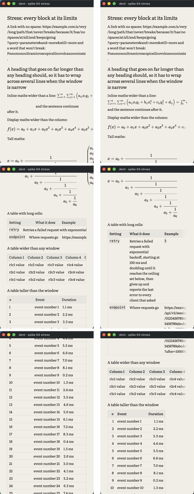
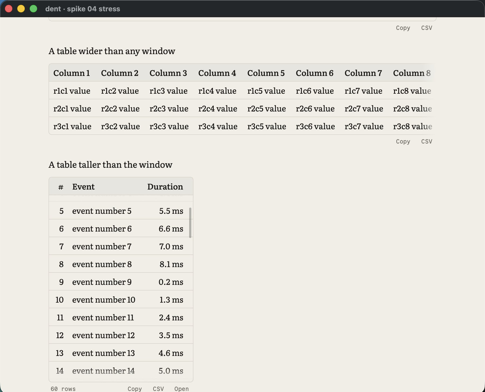
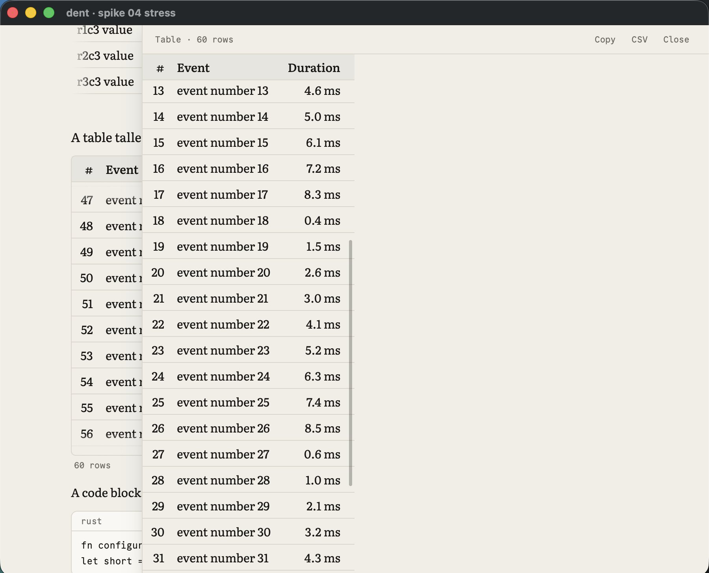
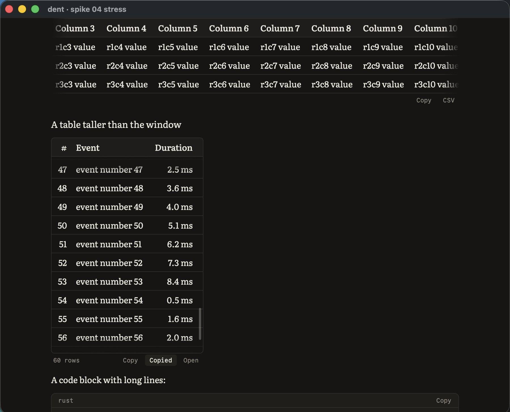

# Spike 04: RaTeX, merman and streaming Markdown against real transcripts

Date: 2026-10-11 · pulldown-cmark 0.13.4, RaTeX 0.1.14, merman 0.8.0, resvg 0.46.0 · Apple Silicon, release build for the headless runs, debug build for GPUI · Code: [spikes/markdown](../../spikes/markdown) (headless, a library and a CLI) and `--specimen` in [spikes/gpui-chat](../../spikes/gpui-chat)

Questions:

- Can a stable-prefix layer over pulldown-cmark stream real agent output with finished blocks never moving and nothing flickering?
- Does RaTeX typeset what agents write, and can GPUI draw it natively?
- Does merman render Mermaid headless, in Field Notes, fast enough?

**Answer: yes to all three, with three rules the spec now records.**

- `$…$` is maths only when it looks like TeX.
- Tight and loose lists render the same.
- Glyphs from KaTeX's Size fonts are drawn from their outlines, because GPUI won't load those fonts.

No script engine or web view is needed for maths or diagrams.

The corpus is every assistant message in the local Claude Code and Codex transcripts on the development Mac: 16,114 messages (15,877 Claude Code, 237 Codex), 6.7 MB of text. They were read in place. Only counts and timings were kept; no transcript text is in this repo.


## Streaming

Each message is replayed in chunks and three things are checked after every chunk:

- Committed blocks never change.
- The final result equals a one-shot parse.
- What a reader sees only grows. Text never changes style or block and never vanishes. This is checked as characters tagged with style and block kind, each frame a prefix of the final.

| Replay | Steps | Committed block changed | Final ≠ one-shot | Messages that flicker |
| --- | --- | --- | --- | --- |
| No terminator, 1–12 byte chunks | 1,037,833 | 0 | 0 | 31.8% |
| Terminator, 1–12 byte chunks | 1,037,833 | 0 | 0 | **0.23%** (0.18% of steps) |
| Terminator, every byte | 6,658,815 | 0 | 0 | **0.25%** (0.18% of steps) |

The ~37 messages that still flicker are genuinely ambiguous: a `**` that the rest of the message never closes, an escaped backtick inside a code span, a code span with a leading space. Each flicker lasts a few chunks.

| Cost | p50 | p99 | Worst |
| --- | --- | --- | --- |
| One push (re-parse tail, terminate, re-split) | 5 µs | 62 µs | single outliers vary run to run, up to a few ms |
| A 100 KB code block still streaming | 0.07 ms | | 0.4 ms |
| A 2,000-row table still streaming | 1.3 ms | | 2.6 ms per push at the end, 4.8 ms max |
| A 50 KB single paragraph still streaming | 0.7 ms | | 2.2 ms |

How the layer works:

- **Commit rule:** every top-level block is committed once the line that starts the next block is complete. Committing as soon as a next block merely exists was wrong: a half-typed `2` before `2.` parses as a paragraph, which ended the list above it (138,620 broken steps before this fix).
- **Terminator:** the unfinished tail is rewritten before parsing.
  - It closes open `**`, `*`, `_`, `~~`, code spans (matching backtick run length) and links, following CommonMark's flanking rules.
  - It drops delimiters that have no content yet, and spaces before an auto-closer.
  - It holds back text whose meaning is still unknown: an unclosed `$` or an unresolved `[`.
  - It holds back an ambiguous last line: a fence, table row or `$$` being typed, a bare list or heading marker, a setext underline, or a lone number. It re-checks after holding text back, because hiding `[` can leave `- ` under a line, which would make that line a heading.
- **Cost:** a huge block that stays the tail is re-parsed in full on every chunk. Clients batch the chunks that arrive within a frame into one push, and parse off the UI thread; a row-level commit for long tables can come later if needed.

## Maths

- **Dollar signs:** every one of the 74 `$…$` spans pulldown-cmark found in the corpus was two prices (`$10/mo ($30/mo`), not maths. RaTeX happily "typesets" them, so a failed typeset can't be the guard. Rule: a single-dollar span that starts with a digit or space and contains none of `\ ^ _ {` stays text. After it, one span in the corpus is maths. `$$…$$` is unaffected. No display maths or `\(…\)` appeared in the corpus.
- **Coverage:** RaTeX typeset all 40 fixtures:
  - fractions, roots and big operators with limits;
  - matrices, `aligned`, `cases`, `array` and `gather`;
  - accents, `\left…\right`, `\boxed`, colour, `\xrightarrow`, `\tag`;
  - `\ce` chemistry and `\href`.
- **Speed:** p50 67 µs per formula. `\ce` costs 6 ms the first time (mhchem setup), then normal.
- **Native drawing in GPUI:** RaTeX's display list is glyphs, rules, rects and paths in em units. The specimen draws glyphs with `paint_glyph` in the KaTeX fonts, rules and rects as quads, and radicals and stretchy delimiters with `PathBuilder`. It's crisp at any scale and themed with ink, with no rasterising.
- **GPUI gotcha:** GPUI skips any font without an `m` glyph (a guard in its macOS text system), which silently drops KaTeX_Size1–4. Those fonts hold the big operators and stretchy delimiters, and they fell back to a system face. Glyphs from fonts without `m` are now drawn from their outlines (ttf-parser into `PathBuilder`, cached per glyph). KaTeX_Main, Math, AMS and the rest load normally.
- **Inline maths:** GPUI text can't embed an element or give one run its own size. The paragraph reserves the formula's width with transparent word characters measured from the body font, so the line can't break inside it. A canvas then draws the formula at the text baseline from `TextLayout::position_for_index`.
- **Baseline:** GPUI reports `descent` as a negative number.

## Diagrams


- **The corpus has no mermaid fences**, so coverage comes from 22 fixtures, one per diagram type merman supports.
- **All 22 render headless:** flowchart, sequence, class, state, ER, gantt, pie, mindmap, timeline, gitGraph, journey, quadrant, xychart, sankey, block, architecture, requirement, kanban, C4, packet, radar and treemap. Architecture needs merman's `layout-cytoscape` feature.
- **Speed:** SVG p50 1.3 ms (max 7.8 ms), rasterising at 2x p50 2.9 ms (max 16.7 ms). In the specimen the diagram is ready about 80 ms after its fence closes, on the background executor, including renderer setup.
- **Pipeline:**
  - merman's `ResvgSafe` preset strips `foreignObject` labels.
  - A `HostTheme` maps Field Notes tokens to its roles (canvas, surface, text, border, line, note, actor, series palette).
  - Label widths are measured with the bundled IBM Plex Sans through rustybuzz, so labels fit their boxes.
  - resvg draws with a fontdb holding the bundled fonts, and the pixmap becomes a GPUI `RenderImage`.
- **Streaming:** a mermaid block renders only once committed; until then its source shows dimmed. The first specimen run re-rendered on every chunk while the fence was open.
- **Theming gaps:** a few diagram types ignore the host roles:
  - C4 labels are white on Paper (fine on Carbon);
  - sankey and architecture icons keep their own colours;
  - gantt, journey and treemap headers use tiny labels.

  Mermaid theme variables (`cScale*`, `personBkg`, `archEdgeColor`) fix the timeline but not the rest. Since dent owns the SVG, the fix is a recolour pass that snaps every fill and stroke to the nearest Field Notes token before rasterising.

## Specimen in GPUI

`--specimen` streams a sample message (written for the spike) at 260 characters a second through the same layer and renders the block tree: headings, paragraphs with inline styles and inline maths, lists, a table, display maths, a code block, a Mermaid diagram and a quote.

| Run | Frames | p50 | p95 | p99 | Max | Over 8.3 ms |
| --- | --- | --- | --- | --- | --- | --- |
| Paper | 415 | 2.5 ms | 4.2 ms | 4.6 ms | 6.8 ms | 0 |
| Carbon | 415 | 2.1 ms | 4.0 ms | 4.4 ms | 9.2 ms | 1 (first frame) |

The specimen rebuilds every block's elements each frame. The real chat caches committed blocks, as spike 03's list already does.

## Stress: every block at its limits

`--stress` renders a page where every block is pushed past its limits:
- a link and a word with no break points;
- a heading that wraps over several lines;
- inline maths wider than a line, and display maths wider than the column;
- a tall continued fraction beside a 6×4 matrix;
- a table with long cells, one 14 columns wide, and one with 60 rows;
- a code line of 240 characters;
- a diagram wider than the column and one taller than the window;
- lists nested six deep, and quotes nested three deep.

It was captured at 1440×860, 900×700, 420×700 and 360×560, in Paper and Carbon. Each capture is the dent window only, taken a viewport at a time.



What broke, and the fix for each:

| Problem | Fix |
| --- | --- |
| Table columns didn't line up: each row sized its own cells | All rows share measured column widths: natural width capped at 320 pt, never below the longest word (capped at 160 pt), prose never below 140 pt |
| Long cells, wide tables, display maths and the matrix were clipped with no way to see the rest | Wide content scrolls sideways inside its block, with an edge fade where there is more |
| Inline maths wider than the line ran off the edge and left a blank gap | Over 260 pt it gets a line of its own, which scrolls |
| Code lines wrapped | Code never wraps; it scrolls |
| A wide diagram shrank until its labels were unreadable | Shrink to fit, but never below 75%; then scroll |
| Header words and inline code broke mid-word (`Colum`/`n`, `endpoin`/`t`) | Measure each word in its run's font, headers in medium weight, plus 2 pt of slack |
| Right-aligned columns ignored `---:` | Alignment is honoured |
| **Six-deep nested lists cost 4.8 ms per frame; seven deep cost 9.5 ms** | List items are padded blocks with the marker out of flow, not flex rows. Seven deep now costs 0.87 ms |

The nested-list cost was the real surprise. Each flex row measures its text again at every level, so the cost doubled with each level of nesting:

| List depth | 2 | 3 | 4 | 5 | 6 | 7 |
| --- | --- | --- | --- | --- | --- | --- |
| Before (ms per frame) | 0.99 | 1.90 | 2.56 | 4.02 | 4.93 | 9.46 |
| After | 0.44 | | 0.64 | | 0.75 | 0.87 |

Frame times for the whole stress page, release build, with every block rebuilt every frame:

| Run | p50 | p99 | Over 8.3 ms |
| --- | --- | --- | --- |
| Paper and Carbon, all four sizes | 3.5 ms | 4.8–5.1 ms | 0 |

**Very tall tables were too slow at first.** The whole page was laid out and painted every frame, at about 0.03 ms per table row. 240 rows reached 8.3 ms per frame at p50, and 1,000 rows reached 14 ms. The fix is next.

## Tall tables: capped, scrollable, copyable

Past 13 body rows, a table shows its header and 10½ rows, and scrolls inside the chat.
- **It looks scrollable before anyone touches it:**
  - a half row peeks out at the bottom;
  - the scrollbar is always visible;
  - a fade appears on whichever edge has more;
  - the footer gives the row count.
- **The footer** offers copy as Markdown, copy as CSV, and Open, which shows the whole table in a side panel.
- **Other blocks:** code blocks get a Copy button in their header. Display maths (TeX) and diagrams (Mermaid source) get one on hover.







**Verified with real input.** `--verify` sends wheel and click events through GPUI's normal hit-testing. Wheel input arrives one event per frame, with the start, move and end phases a trackpad sends. The check reads back the scroll offsets and the clipboard, then restores the clipboard. All 14 checks pass at 360×560, 900×700 and 1440×860, and in Carbon:

| Check | Result at 900×700 |
| --- | --- |
| Wheel over a capped table scrolls the table, not the chat | table 120 pt, chat 0 |
| At the table's end, the wheel carries on to the chat | table at its end, chat 1,915 pt |
| Scrolling back up moves the table before the chat | table 120 pt, chat 0 |
| Vertical wheel over a wide table scrolls the chat, never the table sideways | chat 120 pt, table 0 |
| A sideways swipe scrolls the wide table | table 180 pt, chat 0 |
| Copy gives the table as Markdown; CSV gives CSV | exact match |
| Copy on a code block gives exactly its code | exact match |
| Open shows the table in a side panel, which scrolls without moving the chat | panel 1,350 pt, chat 0 |
| Close dismisses the panel | ✓ |
| Search reaches row 47 and scrolls the table to it | ✓ |
| While rows stream in, the capped table keeps its height | 52 frames, all 403.5 pt |

**What GPUI needed.** Each of these was caught by a check, not by looking at screenshots:
- **Every scroller under the pointer takes the wheel.** GPUI doesn't stop a wheel event once one scroller uses it, so a table and the chat would scroll together. The table now handles this itself. It checks whether it can still move in the wheel's direction; if it can, it keeps the event. At either end, the event goes on to the chat.
- **Horizontal scrollers turn vertical wheel motion into sideways scrolling**, and the vertical chat turned sideways swipes into vertical scrolling. Both are now locked to their own axis (`restrict_scroll_to_axis`).
- **GPUI's list only knows the heights of rows it has drawn.** Its scroll end sat short of the real one, so the wheel handed off to the chat with rows still hidden. A uniform row-height hint fixes it.
- **A GPUI bug: a zero-movement wheel event cancels a frame's list scrolling.** The list merges a frame's wheel movements by sign, and `0.0.signum()` is `+1`. So the zero-movement "gesture ended" event a trackpad sends discarded the last movement in that frame. Zero-movement events over a table are now kept away from the list.
- **The side panel blocks pointer input to the chat behind it.** Without that, scrolling the panel also scrolled the chat.

**Streaming tables, row by row.** A table can't be committed until something follows it, so every chunk used to re-parse the whole table, and the renderer re-measured every cell each frame. Now both work a row at a time:
- **Parser:** while the tail is a table and each new complete line is a row, that row is parsed once against the table's header and appended. Anything else falls back to the full parse: a blank line, a line without a leading pipe, a list or a heading.
- **Renderer:** each complete row is measured once and shared. The renderer also borrows the parsed blocks instead of copying their events every frame.

Checks on the row path:
- `tables` streams 11 awkward shapes, each in 20 chunkings: ragged rows, escaped pipes, inline code, maths, links, indentation, a row without a pipe, two tables, and a table followed by a list or a heading. After every chunk it compares the row path with the full parse it replaces. Result: 45,170 steps and 0 mismatches. Unit tests cover the same cases byte by byte.
- The comparison also caught a bug in the old terminator. It recognised a delimiter row only with `--`, but GFM allows a single `-`, so every last row of such a table was hidden as an unconfirmed header. It's fixed.
- The full replay of real messages still has 0 committed blocks changed and 0 final mismatches. Flicker went from 0.23% to 0.22% of messages.

| Parser, 8-byte chunks | Before | After |
| --- | --- | --- |
| 2,000-row table, last 10% of pushes (p50) | 2.6 ms | 0.00 ms |
| 2,000-row table, worst push | 4.8 ms | 0.12 ms |

**Frame times, release build, whole stress page:**

| Tall table rows | While streaming (p50 / p99) | Once finished (p50 / p99 / max) |
| --- | --- | --- |
| 60 | 1.3 / 3.8 ms | 3.4 / 5.3 / 5.7 ms |
| 1,000 | 3.3 / 6.2 ms | 3.5 / 5.1 / 5.8 ms |
| 5,000 | 3.5 / 6.8 ms (was 11 / 24) | 3.2 / 5.4 / 5.7 ms |
| 10,000 | 3.7 / 7.4 ms | 3.3 / 6.0 / 6.2 ms |

A table's length no longer matters, whether it's streaming or finished. All 14 interaction checks also pass with a 5,000-row table streaming in.

## How streaming should feel

`--compare` streams the specimen reply three ways, side by side, all fed the same bursty arrival timing: bursts of 4–22 characters every 25–70 ms, with a 200–450 ms pause every 23 bursts.
- **As it arrives:** text appears when each burst lands, mid-word if need be.
- **Smoothed:** arrivals are revealed a whole word at a time, at a pace that never trails them by much more than 0.25 s. New words fade in over 180 ms, tracked per inline in rendered characters, so markup never counts.
- **Block by block:** a block appears once another block has started after it, fading in over 300 ms.

The comparison panes hide hover-only actions, and the window hides the pointer while recording.

**Outcome:** the owner watched the recordings:
- word by word felt fastest;
- block by block was the easiest to read;
- smoothed was pleasant at half speed.

The way text appears is now a setting, word by word by default ([0034](../decisions/0034-streaming-reveal-setting.md)). For the test reply (107 bursts over 6.5 s), the number of redraws is:
- word by word: 107;
- block by block: 11, plus 198 fade frames at 60 Hz;
- smoothed: 415 at 60 Hz and 831 at 120 Hz.

**Starting the agent early.** This was measured without calling a model:
- Claude Code takes a median of 626 ms (550–683) from launch to answering the `initialize` handshake.
- `codex app-server` takes 30 ms to answer `initialize`.
- Sessions already keep their process alive, so pre-starting Claude would save about 0.6 s on the first message of a new or resumed session only. Any startup work after the first prompt can't be measured without sending one.
- Not worth another moving part yet; it's noted as an optional optimisation.

## What changes in the spec

- **chat-rendering.md:**
  - Maths draws natively from RaTeX's display list.
  - Mermaid goes through merman to SVG to resvg off the UI thread, and is themed through a host theme plus a recolour pass.
  - Neither needs a script engine or web view.
  - The streaming section gains the commit rule, the terminator's hold-back rules, the dollar rule, and "tight and loose lists render the same".
- **risks.md:** "Mermaid and math have no mature pure-Rust renderers" is resolved.
- **Decisions 0013–0015:** confirmed.
- **Dependencies for production:** resvg (already in GPUI's tree), rustybuzz and ttf-parser need decision records when the renderer moves into a crate.

## Run it

```
cargo run -p spike-markdown --release -- stats      # what the corpus contains
cargo run -p spike-markdown --release -- stream     # replay invariants (add --bytes for every byte, --raw without terminator)
cargo run -p spike-markdown --release -- math       # RaTeX fixtures and corpus spans
cargo run -p spike-markdown --release -- mermaid DIR  # all diagram types, Paper and Carbon PNGs
cargo run -p spike-markdown --release -- worst      # huge single-block tails
cargo run -p spike-markdown --release -- tables     # row-at-a-time tables against the full parse
just dev spike-gpui-chat --specimen [--dark] [--bench --shots DIR]
just dev spike-gpui-chat --stress [--size WxH] [--dark] [--bench --shots DIR]   # STRESS_ROWS=n, STRESS_FILE=page.md
just dev spike-gpui-chat --verify [--size WxH] [--dark] [--shots DIR]   # scripted wheel and click checks
just dev spike-gpui-chat --compare [--dark] [--size WxH] [--record FILE]   # three ways to stream, side by side
```
