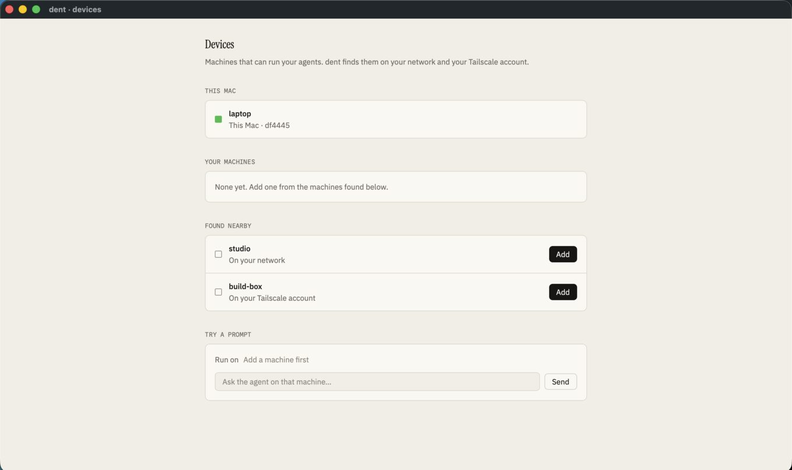
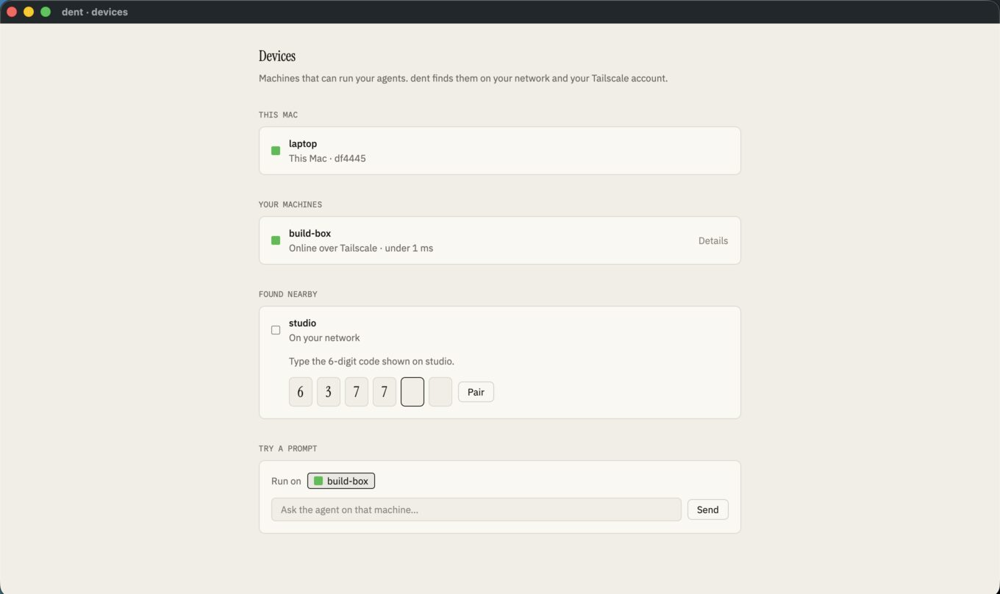
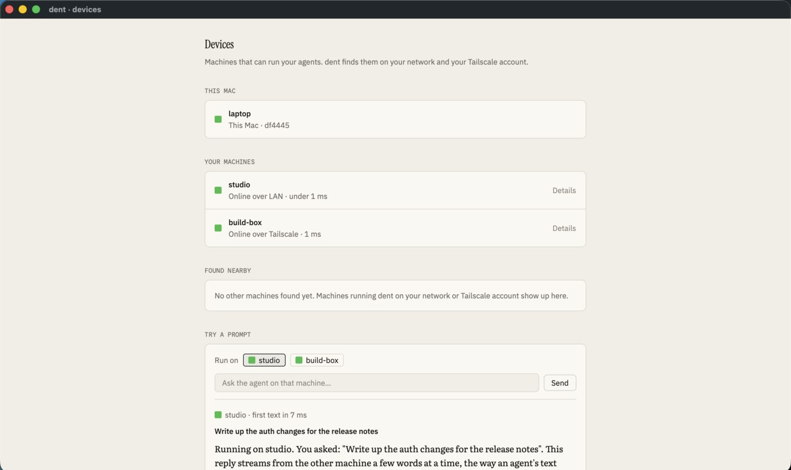
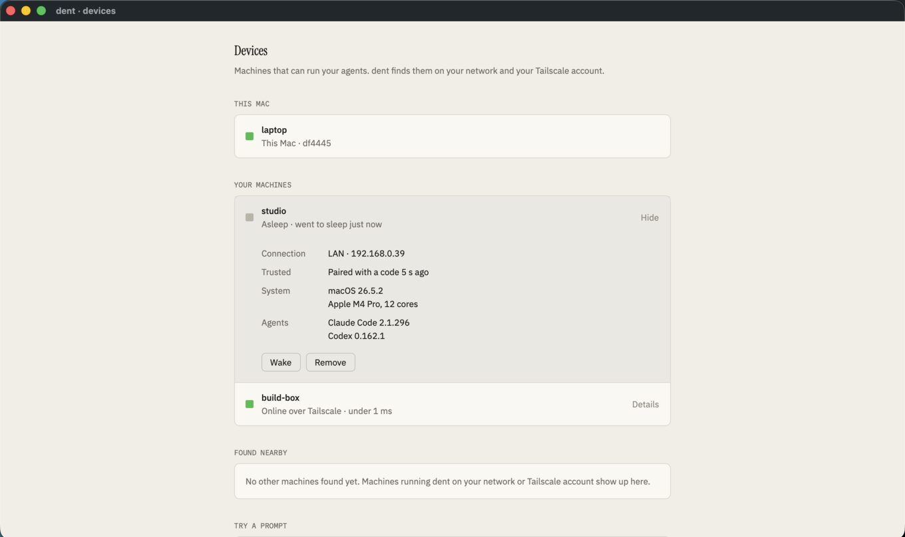
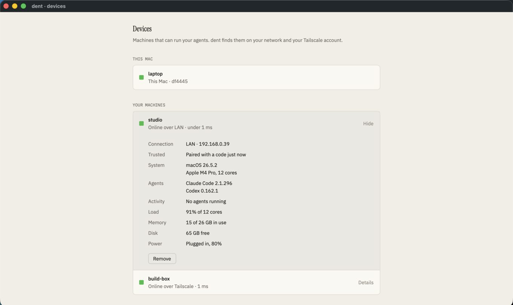
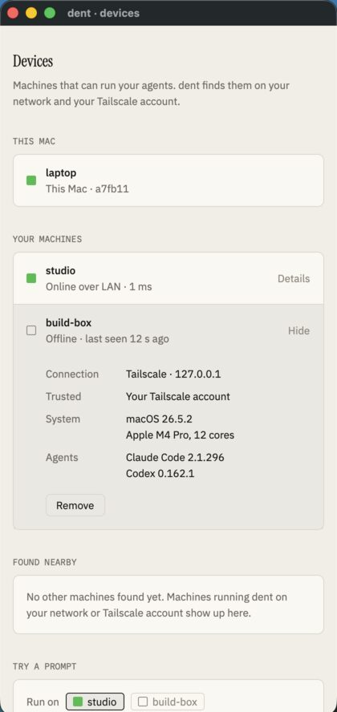
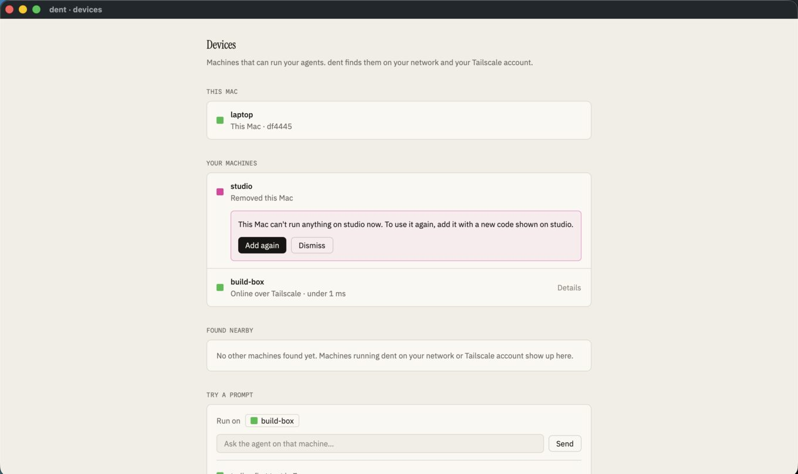

# Spike 05: direct device links over the LAN and Tailscale, with pairing

Date: 2026-10-12 · Rust, tokio, tokio-tungstenite 0.26.2, snow 0.9.6 (Noise), spake2 0.4.0, mdns-sd 0.21.5 · Apple Silicon, release build · Code: [spikes/link](../../spikes/link) (library, daemon and test harness) and `--devices` in [spikes/gpui-chat](../../spikes/gpui-chat)

Questions:

- Can a second machine be set up so it simply shows up in Settings and connects?
- Can it be trusted safely: with a short code on a LAN, and with no code on your own Tailscale account?
- Does running a prompt there stream back reliably through crashes, sleep, address changes and a bad network?

**Answer: yes.** There was only one machine to test on, so a second daemon process on this Mac stands in for the other machine. It has its own identity, state folder and ports, and it's reached over the LAN address (192.168.0.39), not loopback. Tailscale is installed here but switched off, so the Tailscale account check is simulated behind the same interface the real one uses (`tailscale whois`). Prompts go to a fake agent that streams a reply, so no usage was spent.



## Three ways to connect

1. **LAN:** machines on the same network find each other with Bonjour. The first time, you pair with a 6-digit code shown on the other machine.
2. **Tailscale:** dent asks Tailscale which machines are in your account. A machine signed into the same account is trusted with no code. A machine on another account still needs the code.
3. **Relay (later):** a hosted server for machines that can't reach each other directly. Free for up to 3 devices, paid beyond. Not built yet.

All three carry the same protocol over the same encrypted channel. They differ only in how a machine is found and first trusted.

## How it works

- **Identity:** each daemon and each client has a long-lived X25519 key pair, kept in its state folder. A device's ID is a short fingerprint of its public key.
- **Every connection is encrypted and authenticated:** Noise XX over a WebSocket. Both ends prove their key in the handshake, on Tailscale too. Tailscale's own encryption isn't relied on; it would just be a second layer.
- **Pairing with a code:**
  - A 6-digit code is too short to use as a key, so both sides run SPAKE2 with it. An eavesdropper learns nothing, and an attacker gets one guess per attempt.
  - Each side then sends an HMAC of the channel's handshake hash under the agreed key. That ties the code to the keys of that exact connection, which rules out a man in the middle.
  - Pairing is open only while a code is showing on the other machine, for 10 minutes. Three wrong codes show a new code and pause pairing; ten close it. A code works once.
- **Tailscale trust:** the daemon asks Tailscale who owns the connecting address, on every connection. If it's the same login as the daemon's own, the device is trusted with no code, over Tailscale only.
- **Remembered trust:** both sides save each other's key. On every later connection the client checks that the key is the one it paired with, so a different machine at the same address is refused.
- **Streams:** the daemon logs every event with a sequence number before sending it. The client:
  - follows a session from the last sequence number it has;
  - pings every second and treats 3 s of silence as offline;
  - reconnects with backoff (100 ms doubling to 2 s), looking up the address again each time.
- **Removing a device** takes effect on its next message, within about a second.



## Results

`cargo run -p spike-link --release -- test` runs 16 scenarios against the second daemon. All 16 pass, and the run was repeated three times with the same result.

| Scenario | Result |
| --- | --- |
| Bonjour finds the other machine on the LAN | 0.8 s, at 192.168.0.39 |
| An unpaired device is refused before it can run anything | refused |
| Wrong codes are rejected; three change the code | 3 of 3 rejected, code changed |
| The code shown on the other machine pairs them, both ways | 2 ms |
| Paired devices reconnect with no code, even after a restart | ✓ |
| A different machine at the same address is caught by its key | refused |
| Your own Tailscale account: trusted with no code | ✓ (simulated account check) |
| Someone else's Tailscale account: still needs the code | ✓ (simulated) |
| Nothing readable crosses the network (passive tap on every byte) | 0 of 4 known strings found |
| A prompt runs on the other machine and streams back in order | first text in under 1 ms, log to client p50 1 ms |
| A 100,000-event session catches up over the link | 0.68 s, about 147,000 events/s |
| The other machine crashes mid-reply and restarts | back 1.5 s after the crash (0.8 s of it down), 38 of 38 events, 0 gaps, 0 repeats |
| The other machine freezes like a sleeping laptop, then wakes | offline shown after 3.0 s, back 1 ms after waking, 0 gaps, 0 repeats |
| It comes back on a new port | found again by Bonjour and reconnected in 0.8–0.9 s |
| The connection is cut every 0.7 s | 20,027 of 20,027 events, 4 reconnects, 0 gaps, 0 repeats |
| The device is removed on the other machine | cut off within 1.0 s; reconnecting is refused |

## The Devices screen

`just dev spike-gpui-chat --devices` opens Settings › Devices in GPUI. It starts two daemons on this Mac:
- **studio:** on the LAN, announced with Bonjour, pairs with a code;
- **build-box:** on the simulated Tailscale account, trusted with no code.

The screen has four sections:
- **This Mac:** this device's name and ID.
- **Your machines:** paired machines, each a status square, a name and one plain status line. Click one for its details: connection, trust, system, agents, activity, and Wake or Remove.
- **Found nearby:** machines found but not added, each with an Add button. Adding a LAN machine opens inline code entry.
- **Try a prompt:** choose an online machine and send. The reply streams back with the time to first text.

`--devices --demo` plays the whole walkthrough:
1. Both machines appear.
2. build-box connects with no code.
3. studio asks for its code, which is typed in, and pairs.
4. A prompt runs on studio; first text in 3–4 ms.
5. studio is stopped and shows offline after 3 s.
6. studio is restarted and comes back online.

The UI-independent part is `spike_link::devices`: discovery, pairing, status and replies behind commands and a snapshot. It's the shape the client core will take.



## When machines go away

A second pass, as QA would run it: what a person sees when a machine sleeps, crashes, quits, moves or is removed, what happens to prompts and replies in flight, and what an attacker on the network can do. `cargo run -p spike-link --release -- test edges` runs 34 scenarios: 18 against the protocol, and 16 through the device manager (`spike_link::devices`, the code the Settings screen uses), checking what it shows. All 34 pass, as do the original 16, on repeated runs.

### What you see

| State | Meaning | How it's known |
| --- | --- | --- |
| Online over LAN · 1 ms | Connected; round trip from pings | Live link |
| Reconnecting… | Lost without warning moments ago | 3 s of silence |
| Asleep · went to sleep 2 min ago | It said it was going to sleep | The machine says goodbye on its way down |
| Restarting dent… / dent isn't running · quit 5 min ago | dent restarting to update, or quit | Goodbye |
| Offline · last seen 12 s ago | No word for 10 s, or not reached since the app opened | Clock; last seen is kept across app restarts |
| Removed this Mac | The other machine removed this one | It refuses the link; this side then forgets its key |
| Needs a dent update | Protocol versions don't overlap | Exchanged on every connection |



### Results

| Scenario | Result |
| --- | --- |
| Goes to sleep mid-reply | Asleep shown 22 ms after it said so (a silent machine takes 3 s); the reply shows paused, then finishes after waking (back 2.2 s later), all 322 characters |
| A prompt for a machine that's away | Refused on the spot ("studio is asleep. Nothing was sent."); nothing ran there. Prompts are never queued: one starting hours after it was typed would be a surprise |
| Crashes mid-reply | Reconnecting 22 ms after the link drops, offline at 10 s, back 1.5 s after restarting; the cut-off reply is marked interrupted |
| Quits, or restarts to update | Shown as such within 22 ms, and stays that way rather than decaying to offline |
| The app opens while a machine is off | Offline with the last-seen time from before, 22 ms after start |
| The app quits mid-reply | Reopened, the saved part shows before any network, then the rest streams in; no gaps or repeats |
| The app is closed for a whole reply | The agent keeps going there; reopening catches up the finished reply |
| It freezes as a prompt is sent | Says it wasn't confirmed after 12.8 s; Retry runs it exactly once |
| A prompt is sent twice (lost acknowledgement) | Runs once; the second is told it's a repeat |
| Two devices watch one reply | Both get every word |
| Removed on the other machine | Shown as removed within 1 s; its key is forgotten here; Add again pairs with a new code |
| Removed here | The other machine forgets this one within 32 ms, or when it's next seen if it was off |
| A fake announcement using a paired machine's id | Can't rename it or take its place; reconnects to the real one by key |
| Reinstalled (same name, new identity) | Listed as new, with a note that it may be the offline one; still needs a code |
| An unpaired machine goes away | Leaves the list after about 10 s |
| Trusted through Tailscale, also on the LAN | Connects over Tailscale, with no code, before and after a restart |
| An address that never answers | Fails in 3 s, not the OS's minute; a good address listed after two dead ones connects in 0.5 s, because addresses are tried in parallel a quarter second apart |
| Incompatible dent versions | Named as needing an update; retries every 30 s rather than hammering |

### Pairing and trust, attacked

| Scenario | Result |
| --- | --- |
| Three wrong codes | A new code shows and pairing pauses (1 s, doubling); even the right code waits |
| Ten wrong codes | Pairing closes until someone shows a new code; the new code works once, then pairing closes again. At most 10 guesses per code shown: 1 in 100,000 |
| A code left showing | Stops working after 10 minutes |
| Trust from your Tailscale account | Holds only over Tailscale, not the LAN; ends when the device leaves the account; a removal sticks even on your own account |
| Looking for machines (discovery probes) | Never makes them trust you |
| What unpaired devices learn | Nothing: no OS, agents or addresses |
| 200 silent connections from one machine | Another device still connects in 1 ms; 8 are allowed per address, the rest closed at once, all closed within 5 s |
| A 1 MB message before pairing | Refused; the daemon carries on |
| A damaged trust file | Set aside; nobody is trusted until paired again (fails safe) |
| A damaged identity key | The daemon refuses to start rather than quietly becoming a new machine |
| 50 pairings saved at once | All 50 stick (writes are atomic and serialised) |

### Bugs this pass found and fixed

- A prompt sent to an offline machine vanished: no error, and the reply sat at "sending…" forever.
- Discovery probed Tailscale machines one at a time with no limit on the handshake, so one machine that stopped answering froze discovery for everyone.
- The pairing code could be guessed: three tries per code, unlimited codes, about half an hour at network speed. Now 10 guesses per code shown.
- Trust from Tailscale was saved like a paired code, so it outlived leaving the account and worked over the LAN too. Merely probing for machines also created it.
- Adding a machine that already trusted this one hung forever waiting for a pairing reply.
- Every address but the first was ignored when adding, pairing or sending, so a stale address or a VPN interface listed first broke all three.
- An announcement on the network could overwrite a paired machine's address and name.
- Being removed on the other side looped between "connecting" and "available".
- Session ids came from the process id, so two clients could collide.
- Last seen was kept as a monotonic clock, which pauses while a Mac sleeps and is lost on restart.
- A visit from a device could bring back its trust entry a moment after it was removed.
- A machine saying goodbye could be reconnected to in the 150 ms before it went.
- A prompt sent just before the app quit could be lost, because replies were saved on a timer.
- The trust file was rewritten in place (a crash mid-write lost every pairing), and a damaged identity key crashed the daemon.

## What each machine reports

Paired devices get this once per connection:
- OS and version;
- chip and core count;
- dent version and protocol range;
- agent CLIs and their versions (from `--version`, which never touches the provider);
- network hardware addresses for Wake-on-LAN;
- time zone.

Every 5 seconds while watched, they also get:
- load;
- memory;
- disk;
- battery;
- agents running.

The device keeps, per machine:
- how it was trusted, and when;
- last seen;
- every route it's been found on;
- the route in use and its round trip.

Wake sends a magic packet. It works for Macs on power with Wake for network access turned on; on Wi-Fi it depends on a Bonjour sleep proxy, which needs a second machine to confirm.



## The Devices screen, redesigned

The first version crammed addresses, versions and health into rows of monospace text with buttons on every line, and it broke at narrow widths. Now:
- Each row is a status square, a name and one plain line ("Asleep · went to sleep 2 min ago").
- Details open on click as a label and value grid, with Wake and Remove at the bottom.
- States that need you (removed this Mac, needs an update, a possible reinstall) get the approval card's wash.
- Signal colours are fills only.
- It holds at 420 pt wide and in Carbon.

`just dev spike-gpui-chat --devices --demo away` plays sleep, wake, a crash, offline, and studio removing this Mac.

| Narrow | Removed on the other machine |
| --- | --- |
|  |  |

## What changes in the spec

- **Decision 0033:** settled how a plain LAN connection is encrypted. Every connection uses Noise XX with each device's key; pairing on a LAN uses a 6-digit code through SPAKE2 bound to the channel; your own Tailscale account is trusted with no code.
- **hub.md:** the three ways to connect, with the relay as the later, paid-beyond-3-devices option.
- **Liveness:** 3 s of silence means reconnecting and 10 s means offline; asleep, restarting and quit are announced. Clients ping every second while connected ([hub.md](../hub.md#honest-liveness)).
- **Pairing window and Tailscale trust:** added to decision 0033.
- **What machines report:** [remote-machines.md](../remote-machines.md#always-on-machines).
- **Still to prove on real hardware:**
  - Tailscale's account check against a real second machine, once Tailscale is on. `cargo run -p spike-link -- tailscale` prints what Tailscale reports.
  - Bonjour across a real network rather than to itself.
  - Wi-Fi switching and real sleep.
- **Dependencies for production:** snow, spake2, mdns-sd and tokio-tungstenite each need a decision record when this moves into the daemon and client core.

## Run it

```
cargo run -p spike-link --release -- test           # all 50 scenarios (test links: the 16; test edges: the 34)
cargo run -p spike-link --release -- daemon --state DIR [--name N] [--lan ADDR] [--tailnet ADDR] [--proto N] [--pair-ttl S] [--agent-ms MS]
cargo run -p spike-link --release -- tailscale      # what the local Tailscale app reports
just dev spike-gpui-chat --devices [--demo x | --demo away] [--dark] [--size WxH]
```
