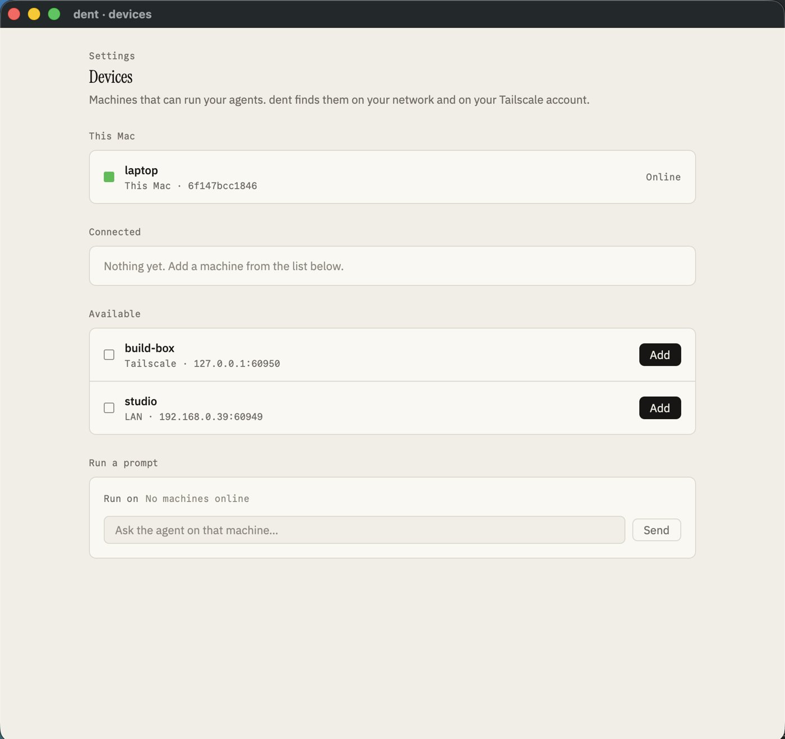
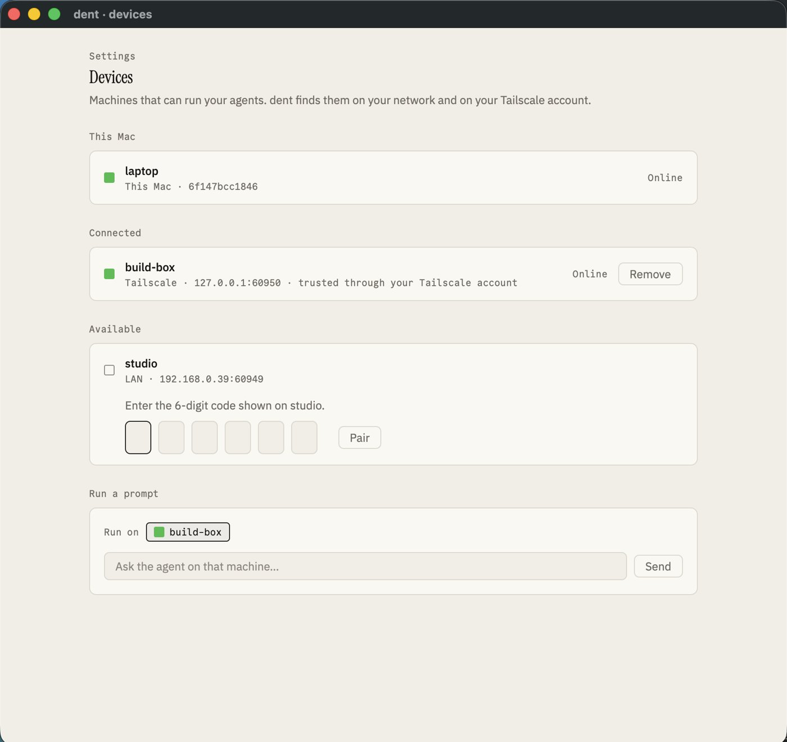
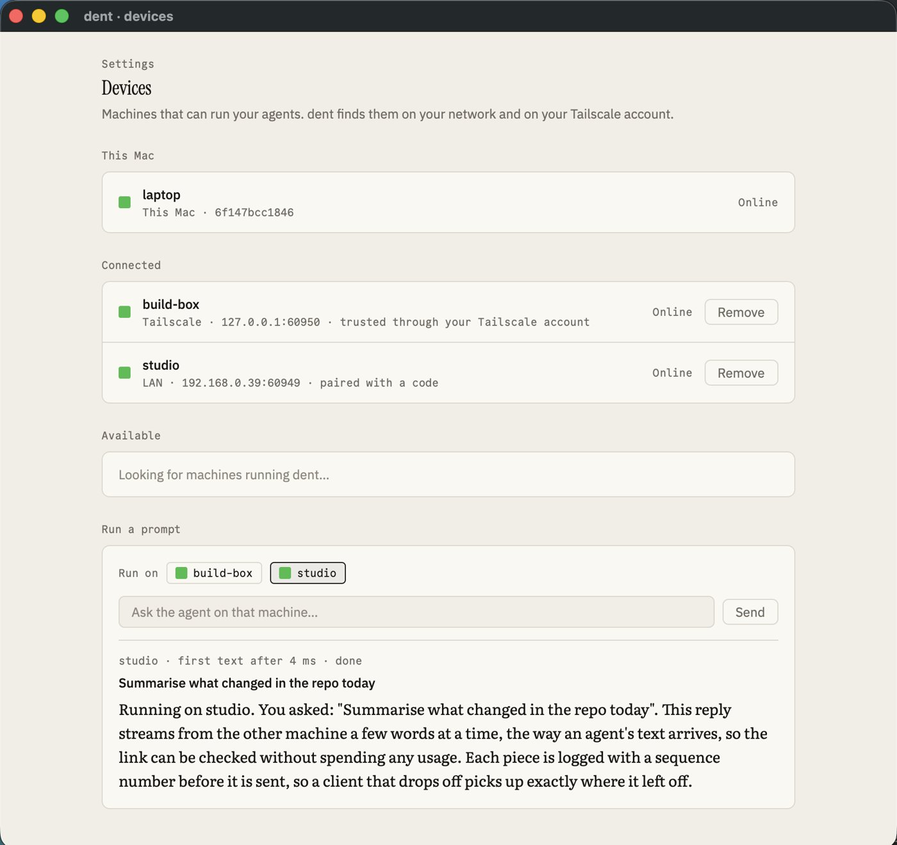

# Spike 05: direct device links over the LAN and Tailscale, with pairing

Date: 2026-10-12 · Rust, tokio, tokio-tungstenite 0.26.2, snow 0.9.6 (Noise), spake2 0.4.0, mdns-sd 0.21.5 · Apple Silicon, release build · Code: [spikes/link](../../spikes/link) (library, daemon and test harness) and `--devices` in [spikes/gpui-chat](../../spikes/gpui-chat)

Questions:

- Can a second machine be set up so it simply shows up in Settings and connects?
- Can it be trusted safely: with a short code on a LAN, and with no code on your own Tailscale account?
- Does running a prompt there stream back reliably through crashes, sleep, address changes and a bad network?

**Answer: yes.** There was only one machine to test on, so a second daemon process on this Mac stands in for the other machine. It has its own identity, state folder and ports, and it's reached over the LAN address (192.168.0.39), not loopback. Tailscale is installed here but switched off, so the Tailscale account check is simulated behind the same interface the real one uses (`tailscale whois`). Prompts go to a fake agent that streams a reply, so no usage was spent.



## Three ways to connect

1. **LAN:** machines on the same network find each other with Bonjour. The first time, you pair with a 6-digit code shown on the other machine.
2. **Tailscale:** dent asks Tailscale which machines are in your account. A machine signed into the same account is trusted with no code. A machine on another account still needs the code.
3. **Relay (later):** a hosted server for machines that can't reach each other directly. Free for up to 3 devices, paid beyond. Not built yet.

All three carry the same protocol over the same encrypted channel. They differ only in how a machine is found and first trusted.

## How it works

- **Identity:** each daemon and each client has a long-lived X25519 key pair, kept in its state folder. A device's ID is a short fingerprint of its public key.
- **Every connection is encrypted and authenticated:** Noise XX over a WebSocket. Both ends prove their key in the handshake, on Tailscale too. Tailscale's own encryption isn't relied on; it would just be a second layer.
- **Pairing with a code:**
  - A 6-digit code is too short to use as a key, so both sides run SPAKE2 with it. An eavesdropper learns nothing, and an attacker gets one guess per attempt.
  - Each side then sends an HMAC of the channel's handshake hash under the agreed key. That ties the code to the keys of that exact connection, which rules out a man in the middle.
  - Three wrong codes change the code. A code works once.
- **Tailscale trust:** the daemon asks Tailscale who owns the connecting address. If it's the same login as the daemon's own, the new device is trusted with no code.
- **Remembered trust:** both sides save each other's key. On every later connection the client checks that the key is the one it paired with, so a different machine at the same address is refused.
- **Streams:** the daemon logs every event with a sequence number before sending it. The client:
  - follows a session from the last sequence number it has;
  - pings every second and treats 3 s of silence as offline;
  - reconnects with backoff (100 ms doubling to 2 s), looking up the address again each time.
- **Removing a device** takes effect on its next message, within about a second.



## Results

`cargo run -p spike-link --release -- test` runs 16 scenarios against the second daemon. All 16 pass, and the run was repeated three times with the same result.

| Scenario | Result |
| --- | --- |
| Bonjour finds the other machine on the LAN | 0.8 s, at 192.168.0.39 |
| An unpaired device is refused before it can run anything | refused |
| Wrong codes are rejected; three change the code | 3 of 3 rejected, code changed |
| The code shown on the other machine pairs them, both ways | 2 ms |
| Paired devices reconnect with no code, even after a restart | ✓ |
| A different machine at the same address is caught by its key | refused |
| Your own Tailscale account: trusted with no code | ✓ (simulated account check) |
| Someone else's Tailscale account: still needs the code | ✓ (simulated) |
| Nothing readable crosses the network (passive tap on every byte) | 0 of 4 known strings found |
| A prompt runs on the other machine and streams back in order | first text in under 1 ms, log to client p50 1 ms |
| A 100,000-event session catches up over the link | 0.68 s, about 147,000 events/s |
| The other machine crashes mid-reply and restarts | back 1.5 s after the crash (0.8 s of it down), 38 of 38 events, 0 gaps, 0 repeats |
| The other machine freezes like a sleeping laptop, then wakes | offline shown after 3.0 s, back 1 ms after waking, 0 gaps, 0 repeats |
| It comes back on a new port | found again by Bonjour and reconnected in 0.8–0.9 s |
| The connection is cut every 0.7 s | 20,027 of 20,027 events, 4 reconnects, 0 gaps, 0 repeats |
| The device is removed on the other machine | cut off within 1.0 s; reconnecting is refused |

## The Devices screen

`just dev spike-gpui-chat --devices` opens Settings › Devices in GPUI. It starts two daemons on this Mac:
- **studio:** on the LAN, announced with Bonjour, pairs with a code;
- **build-box:** on the simulated Tailscale account, trusted with no code.

The screen has four sections:
- **This Mac:** this device's name and ID.
- **Connected:** paired machines, with a status square, how each is reached (LAN or Tailscale) and how it was trusted. Each has a Remove button, and offline machines show "last seen N s ago".
- **Available:** machines found but not added, each with an Add button. Adding a LAN machine opens inline code entry.
- **Run a prompt:** choose an online machine and send. The reply streams back with the time to first text.

`--devices --demo` plays the whole walkthrough:
1. Both machines appear.
2. build-box connects with no code.
3. studio asks for its code, which is typed in, and pairs.
4. A prompt runs on studio; first text in 3–4 ms.
5. studio is stopped and shows offline after 3 s.
6. studio is restarted and comes back online.

The UI-independent part is `spike_link::devices`: discovery, pairing, status and replies behind commands and a snapshot. It's the shape the client core will take.



## What changes in the spec

- **Decision 0033:** settled how a plain LAN connection is encrypted. Every connection uses Noise XX with each device's key; pairing on a LAN uses a 6-digit code through SPAKE2 bound to the channel; your own Tailscale account is trusted with no code.
- **hub.md:** the three ways to connect, with the relay as the later, paid-beyond-3-devices option.
- **Liveness:** 3 s of silence means offline. Clients ping every second while connected.
- **Still to prove on real hardware:**
  - Tailscale's account check against a real second machine, once Tailscale is on. `cargo run -p spike-link -- tailscale` prints what Tailscale reports.
  - Bonjour across a real network rather than to itself.
  - Wi-Fi switching and real sleep.
- **Dependencies for production:** snow, spake2, mdns-sd and tokio-tungstenite each need a decision record when this moves into the daemon and client core.

## Run it

```
cargo run -p spike-link --release -- test           # the 16 scenarios against a second daemon
cargo run -p spike-link --release -- daemon --state DIR [--name N] [--lan ADDR] [--tailnet ADDR]
cargo run -p spike-link --release -- tailscale      # what the local Tailscale app reports
just dev spike-gpui-chat --devices [--demo x] [--dark]
```
