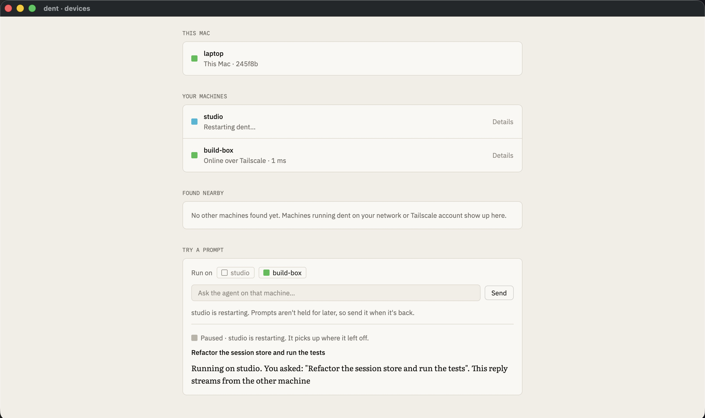
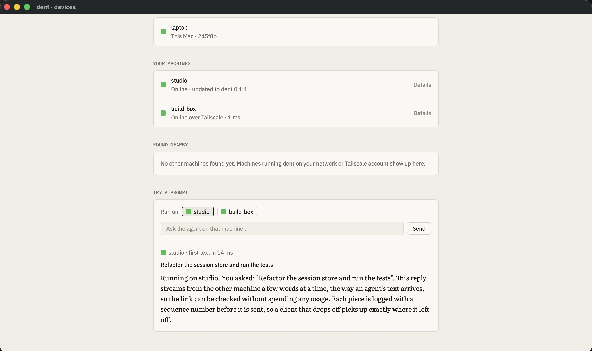
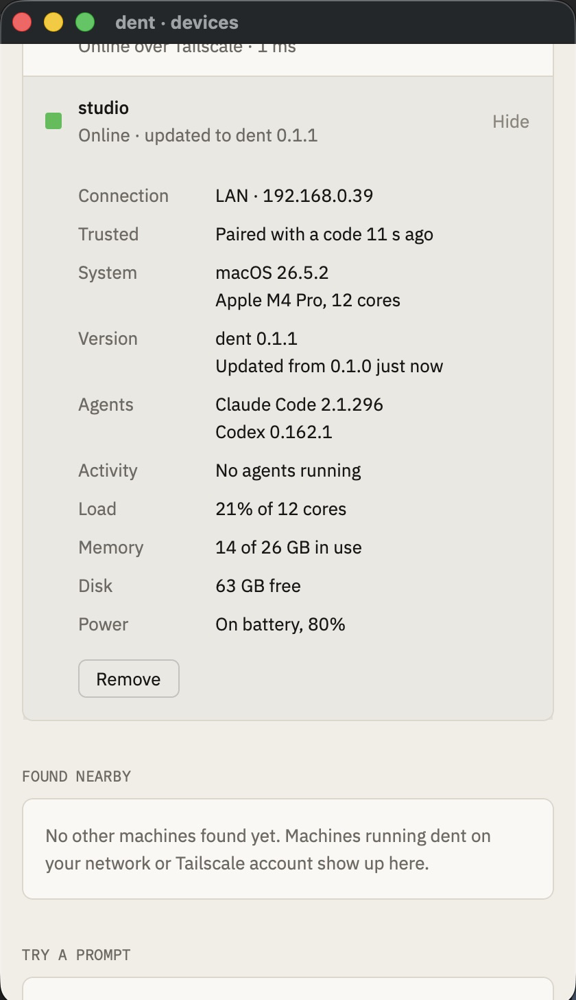
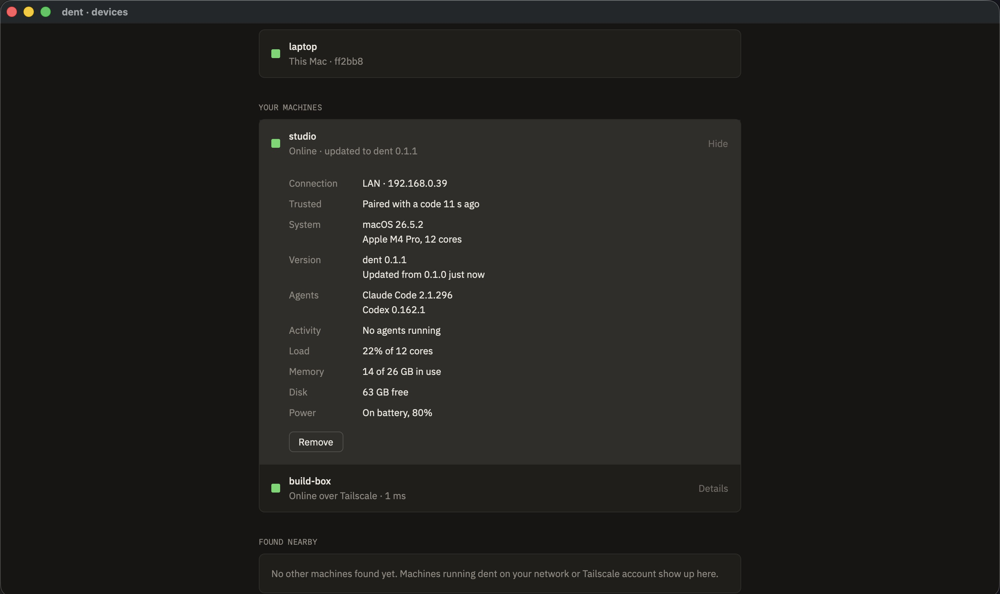

# Spike 06: the session holder surviving a daemon upgrade

Date: 2026-10-12 · Rust, standard library plus libc for the holder, tokio for the daemon's side · Apple Silicon · Code: [spikes/holder](../../spikes/holder) (holder, daemon client, fake agent, stand-in daemon and test harness), wired into the [spike 05](05-direct-links.md) daemon and the `--devices --demo upgrade` scene in [spikes/gpui-chat](../../spikes/gpui-chat)

Questions:

- Can agents keep running while the daemon restarts, crashes or upgrades, with no lost or repeated output?
- Can the holder be small enough that it never needs looking at?
- What does a person see when a machine updates mid-reply?

**Answer: yes, and it's small.** The holder is about 450 lines of standard-library Rust. With launchd restarting the daemon (`launchctl kickstart -k`), an agent run as the daemon's own child was killed, while the same agent run through the holder kept going and its output carried on into the new daemon. Across 23 scenarios, agents' output arrived byte for byte through repeated daemon kills. In the Devices screen, a reply pauses with "studio is restarting", then finishes on the new version.



## How it works

The holder does four things: start a process, pass stdin to it, copy its output to a file, and stream that file to the daemon from any byte offset. Nothing else.

- **One holder per daemon,** started by the daemon on first use and talked to over a Unix socket in a private directory (0700, socket 0600). It leaves the daemon's process group and session (`setsid`), so a service manager stopping the daemon doesn't reach it.
- **Output goes to disk first.** A pump thread per pipe appends to a file and counts what's written. The daemon asks for output "from byte N" and gets the backlog, then live output, then the exit status, in order. A daemon that was away catches up exactly; one that's frozen never blocks the agent.
- **The daemon's resume point is in its own log.** Each event the daemon writes from agent output records which process and which byte it ended at, in the same write. After a restart it asks for output from there. There's no separate offset to drift.
- **Writes are whole or not at all.** The holder reads a full stdin frame before writing any of it, so a daemon killed halfway through sending a prompt delivers nothing, never half a message.
- **One daemon at a time.** The daemon holds a lock on its state; an upgraded daemon started before the old one exits waits for it. As a backstop, a new daemon's hello takes over the holder and tells the old connection "replaced", so the old daemon stops instead of fighting back.
- **Stopping** sends SIGTERM to the agent's process group, then SIGKILL after a grace period, so tools it started stop too.
- **The holder exits on its own** once it has no processes and no daemon for 60 s, and removes its socket.
- **Its directory is derived from the daemon's state path** by SHA-256, under the temp directory. It's short (Unix socket paths are limited to about 100 bytes) and it's the same for every daemon version. A hash that changed between compiler versions would have made an upgraded daemon miss its holder.

The protocol is one JSON line per frame, followed by raw bytes when a frame carries them. Its operations are hello, spawn, write, close-stdin, attach, stop, release, list and exit-when-idle. Operations are only ever added, and the holder reports its protocol version. A daemon that needs a newer holder asks the old one to exit when idle. It keeps using the old holder for the agents it already runs, holds new ones until it has gone, then starts the new holder.

## Results

| Scenario | Result |
| --- | --- |
| 4 agents × 5,000 lines | Byte for byte |
| Daemon killed 10 times mid-stream (SIGKILL and SIGTERM alternately) | Same agents throughout, no gaps; output flowing again 1 ms after each start (worst 15 ms) |
| Agents finish while no daemon is running | Exit code 7 and all output recovered |
| stdin across a restart | The same agent heard both daemons, and ended when stdin closed |
| Daemon dies halfway through a 1 MB write | The agent never saw any of it |
| Upgraded daemon started before the old one exits | Waited, then took over 5 ms after the old one exited |
| A second daemon takes over the holder | The old one stops; no tug of war |
| Holder killed (SIGKILL) | The daemon notices at once, stops the orphaned agents within 6 ms, keeps all output written before the crash, marks the replies interrupted |
| Dead holder's socket file left behind | Replaced; new holder and agent running in 25 ms |
| Three holders started at once | One serves, two exit |
| Stop | SIGTERM stops an agent; one that ignores it is killed after the grace period, along with what it started |
| Daemon frozen (SIGSTOP) | A 20 MB agent finished in 241 ms regardless; as a direct child it stalled once the pipe filled |
| Idle | Holder gone 0.8 s after its idle time; stays while an agent runs |
| Holder upgrade | Old holder kept its two agents to the end, then a new one took the next two |
| Binary output, no final newline | 3 MB of every byte value, exact |
| 256 MB with 3 daemon kills | Exact; 96 MB/s through the holder, 112 MB/s as a direct child (release build) |
| 50 agents, 2 daemon kills | All exact; holder uses 9.2 MB; output flowing 11 ms after a start |
| Latency per line | 79 µs median (p99 193 µs) through the holder, 44 µs (151 µs) direct |
| Bad requests, garbage frames, oversized frames | Refused or that connection closed; the holder and the daemon carry on |
| Socket path too long | Clear error at start |
| Agent exits but something it started holds its output open | Exit reported 2 s later anyway |

In spike 05's daemon:

- A daemon crash mid-reply now ends with the reply finishing after the restart, where it used to be marked interrupted.
- When the whole machine goes (daemon and holder both killed, as in a power cut), the reply is still marked interrupted.
- Spike 05's suites pass: 16 of 16 and 35 of 35.

## What each machine reports, now with its version

The Devices screen shows each machine's dent version in its details. When a machine comes back on a different version, its status says "Online · updated to dent 0.1.1" for ten minutes, and the details say what it was updated from and when. The last version seen is saved, so this survives restarting the app.



| Narrow | Carbon |
| --- | --- |
|  |  |

## Bugs found and fixed

- **The Devices page couldn't scroll.** Its content was squeezed to the window's height, so anything below the fold was out of reach. It now scrolls.
- **"1 agent running" stayed up to 5 s after a reply finished.** Health now goes out as soon as the number of running agents changes.
- **Agents that were never told to stop kept holders alive forever.** A long-lived agent waits on stdin indefinitely. The daemon now closes an agent's stdin after 30 s with no reply under way, and the next prompt starts a new one. The real daemon resumes the agent's session from its transcript.
- **A holder's agents would run unwatched after the holder died.** They only die when they next write. The daemon now stops their process groups as soon as it loses the holder.

## What changes in the spec

- **The holder is started by the daemon, not installed as its own service,** on macOS. Under launchd, `setsid` is enough to survive the daemon's restart. On Linux, systemd stops a service's whole control group, so the daemon starts the holder in its own unit (`systemd-run --user`). That couldn't be tested here.
- **Holder upgrades wait for idle.** Hand-over to a new holder binary without stopping agents (re-exec keeping the pipes) is possible but not worth the complexity yet.
- **dent must live outside protected folders,** and the person must allow access to the ones agents work in. macOS asks before a program started by launchd can read Documents, Desktop or Downloads. The launchd test first ran the binary from this repo under Documents and set off repeated prompts. dent's installer puts the daemon outside these folders. Setup explains the prompt (or Full Disk Access) before the first agent works in a project there, and `dent doctor` checks it. Added to Risks.

## Run it

```sh
cargo run -p spike-holder -- test            # all 23 scenarios
cargo run -p spike-holder -- test launchd    # restart under launchd (adds and removes a temporary job)
cargo run -p spike-link -- test              # spike 05's suites, agents now through the holder
cargo run -p spike-gpui-chat -- --devices --demo upgrade
```
