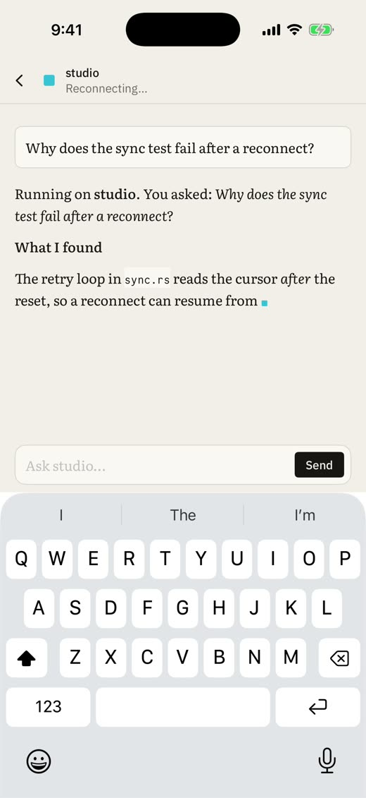
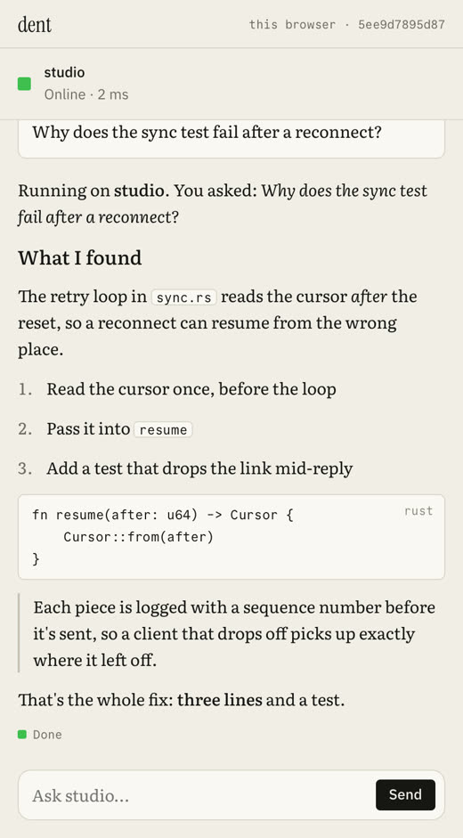
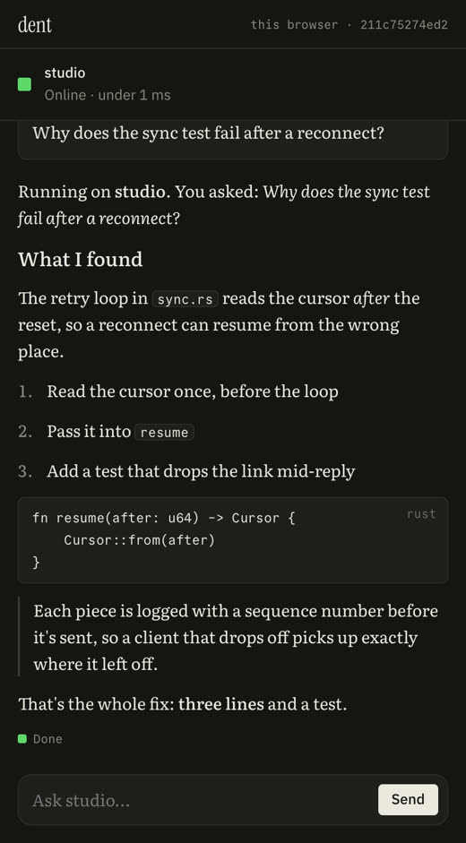
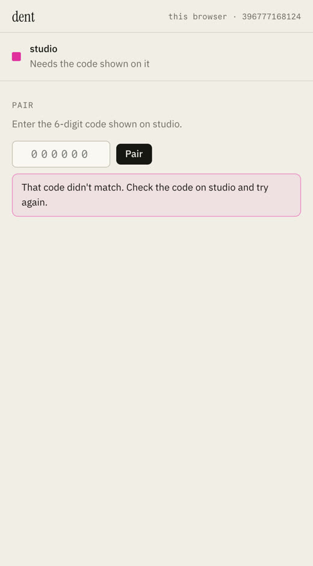
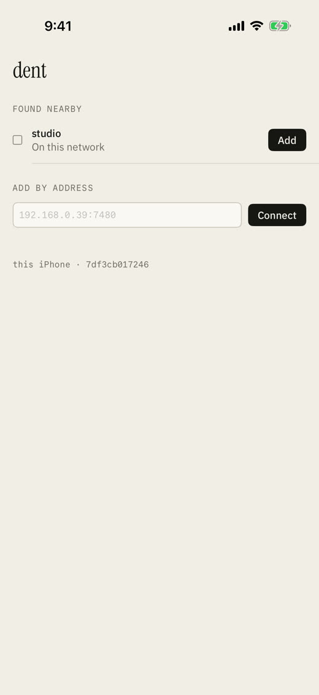
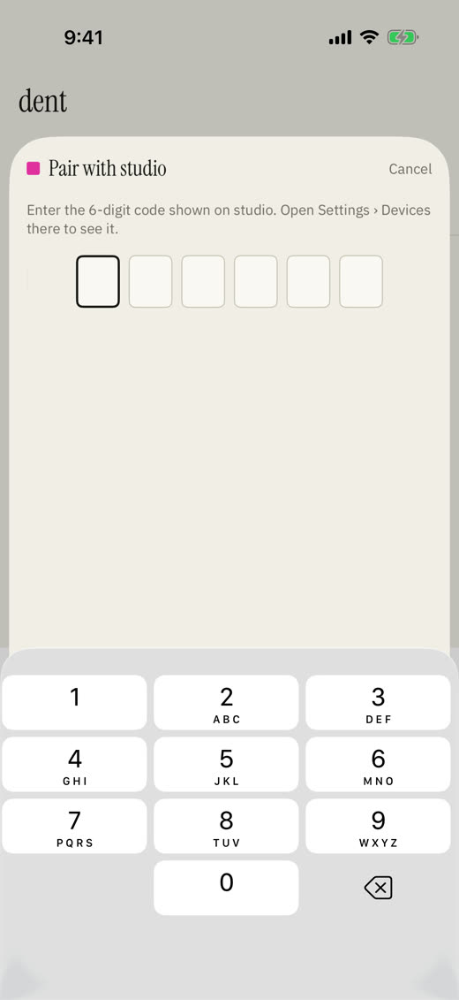
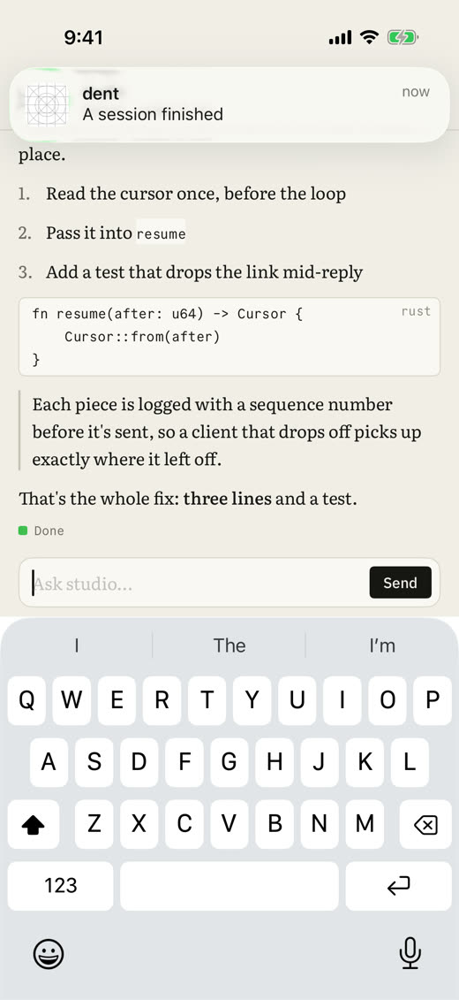
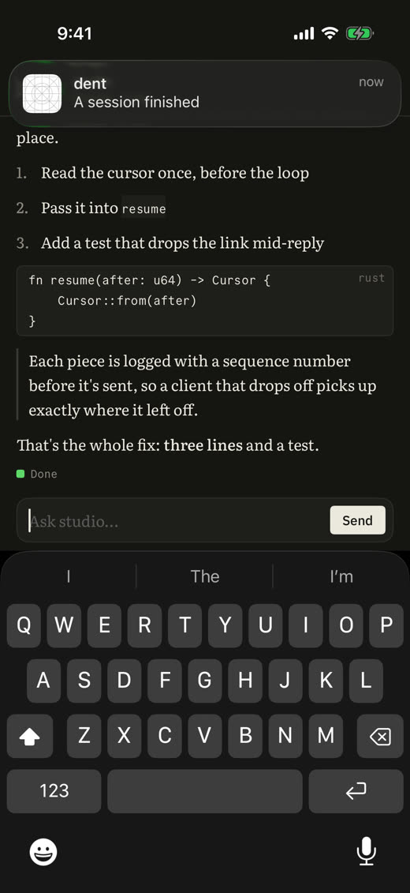
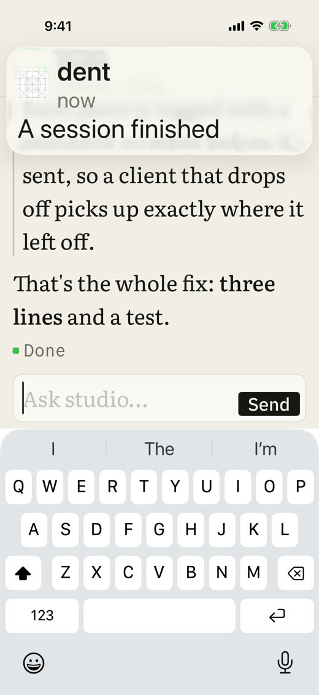
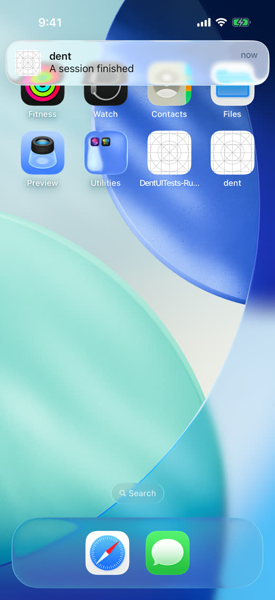

# Spike 07: the client core built for iOS and WebAssembly

Date: 2026-10-12 · Rust (no I/O in the core), UniFFI 0.32.2, wasm-bindgen 0.2.129, SwiftUI on iOS 17+, Xcode 26.2, Chrome, wrangler 4.70.0 · Apple Silicon · Code: [spikes/core](../../spikes/core) (the core), [spikes/core-ffi](../../spikes/core-ffi) (iOS bindings, build script, SwiftUI app), [spikes/core-wasm](../../spikes/core-wasm) (browser bindings and page), [spikes/core-test](../../spikes/core-test) (native harness), [push](../../push) (dent-push)

Questions:

- Can one client core, with no I/O of its own, run unchanged on the desktop, on the iPhone and in a browser?
- Does it hold up against spike 05's daemon: pairing, reconnecting, crashes, a bad network?
- What does it cost in size, speed and build time?
- Can phone notifications be built end to end without an Apple account yet?

**Answer: yes.** The core is plain state machines: the Noise channel, pairing, a link that races addresses and reconnects, sessions, and replies parsed into Markdown blocks. The host owns the sockets and the clock and does what the core asks. The same Rust code passes the same scenarios natively, in Node through WebAssembly, in Chrome, and in the iOS simulator through UniFFI. In the simulator the phone finds the daemon with Bonjour, pairs with its code and streams a reply. The reply survives the daemon restarting mid-stream, and a notification arrives when it finishes.



## How the core works

- **No I/O, ever.** The core never opens a socket, reads the clock or touches the disk. The host calls `take_io` and does what it says: open a WebSocket to an address, send these bytes, close. It reports back with `opened`, `received` and `closed`, and calls `tick` with the time. Time is always an argument, which matters on the web too, where reading the system clock panics.
- **Every connection has a number,** so anything an old socket reports late is ignored. That rules out a whole class of reconnect bugs.
- **Addresses race,** a quarter second apart, as in spike 05. A dead first address costs 250 ms, not the 3 s timeout.
- **Prompts are kept until the daemon acknowledges them.** They're resent on every reconnect with the same id, so one sent offline runs exactly once when the machine is back.
- **Replies become blocks lazily.** Deltas are appended as they arrive and parsed only when the UI takes notes, once per frame. A burst of 10,000 deltas costs one parse.
- **Updates are incremental.** Committed blocks never change, so an update says how many blocks the UI keeps, then lists the rest. A test splits a reply at every byte and checks that kept blocks are always final and that the result matches a one-shot parse.
- **Flat blocks:** paragraph, heading, list item (with depth and marker), code, math, quote level, table row and rule, each a run of styled spans. Every UI lays chat out as a list anyway, and recursive types cross FFI badly.

## The two facades

| | iOS (decision [0023](../decisions/0023-uniffi-own-script.md)) | Web (decision [0024](../decisions/0024-web-wasm-facade.md)) |
| --- | --- | --- |
| Bindings | UniFFI 0.32.2 proc macros, with records and enums derived in the core behind a feature | wasm-bindgen; notes cross as one JSON string per frame, bytes as `Uint8Array` |
| Build | `spikes/core-ffi/build.sh`: a static library per platform, Swift generated from the library by our own bindgen binary, an XCFramework, then xcodegen | `spikes/core-wasm/build.sh`: cargo, wasm-bindgen CLI, fonts |
| Host | `Host.swift`: URLSession WebSockets and a timer on one serial queue; notes handed to the main actor once per frame | `host.js`: WebSockets and `setTimeout`; notes once per animation frame. The same file runs the Node test |
| Size | Whole release app binary 3.0 MB with the core linked in (the static library is 29 MB, mostly metadata the linker drops) | 919 KB wasm, 290 KB gzipped, 233 KB brotli; 21 KB of JS glue |
| Rebuild after a core change | 6.8 s to a new XCFramework and Swift | 1.3 s |

**No async crosses FFI.** Because the core is synchronous and I/O-free, there's nothing to cancel on the Rust side and no runtime to bridge. Swift keeps async and cancellation, as 0023 asked for, and the core is called from one queue, so calls never overlap. This turned out simpler than either UniFFI's async support or a callback interface would be.

## Results

Native harness, `cargo run --release -p spike-core-test`: 14 of 14, against real daemons:

| Scenario | Result |
| --- | --- |
| Unpaired machine | Asks for its code |
| Wrong code, then the right one | Refused, then paired and connected trusted 18 ms after the code |
| A prompt | First text in 18 ms; the blocks equal a one-shot parse of the whole reply |
| Dead first address | Online in 269 ms through the second |
| Prompt sent while the machine is down | Delivered once on reconnect: one user message, acknowledged once |
| Machine crashes mid-reply | Reply finishes whole, 0 gaps, 0 repeats |
| Machine freezes (asleep) and wakes | Offline after 2,988 ms; back 100 ms after waking; reply finishes |
| Connection cut every 0.15 s during 100,000 events | All 100,000 exactly once, 4 reconnects, 0 gaps |
| 100,000-event catch-up | 0.62 s, 161,000 events/s, 9 ms of it building blocks |
| Goodbye before a restart | Redialled 982 ms later |
| A different machine at the known address | Refused ("answered with a different key") |
| Newer protocol | Says so; next try in 29 s |
| Removed on the other machine | Cut off in 17 ms; no more dialling |

WebAssembly in Node, `node spikes/core-wasm/test/node.mjs`: 7 of 7. Finds, pairs (21 ms), streams (first text 24 ms), catches up 100,000 events in 1.15 s (87,000 events/s), parses 250 KB of Markdown in 49 ms. It also checks that a phone over its notification limit, and dent-push being down, both show in the machine's health.

Chrome, `node spikes/core-wasm/test/browser.mjs`: 6 of 6. Pairs in about 100 ms, draws every block type, no sideways scroll at 420 px, reconnects after a reload without a code, finishes a reply the machine restarted in the middle of, and words a wrong code plainly.

| Phone width | Dark | Wrong code |
| --- | --- | --- |
|  |  |  |

iOS simulator, `node spikes/core-ffi/run-sim.mjs`: an XCUITest against a daemon announced over Bonjour, passing in light, dark, the largest accessibility text size, with the daemon restarted mid-reply, and with the daemon frozen as it's added. On the phone, 100,000 events catch up in 3.1 s (32,000 events/s). Only 0.45 s of that is the core; the rest is URLSession at about 26 µs per WebSocket message.

| Found nearby | Pairing | Reply | Dark | Largest text |
| --- | --- | --- | --- | --- |
|  |  |  |  |  |

## dent-push, built and tested locally

[push/](../../push) is the Worker from decision [0035](../decisions/0035-dent-push.md), about 250 lines of TypeScript. `npm test` runs it under `wrangler dev`, against a stand-in for Apple's server that checks the provider token's ES256 signature, the topic and the size. 15 of 15 pass:

- **Handles:** sealed (the token is not visible in the handle), tampering refused, and a handle from before a key rotation still sends.
- **To Apple:** the notice arrives sealed, with time-sensitive priority for approvals; refreshes go as silent background pushes; one provider token is signed and reused.
- **Limits:** five a minute, then 429 with when it clears; the daily cap holds until midnight UTC; the next day it sends again.
- **Bad input:** an unregistered phone comes back as dead; oversized, unknown and malformed requests are refused; one address can't flood it.

End to end in the simulator, the daemon seals a notice when a reply finishes, posts it to dent-push, and dent-push signs and forwards it. The stand-in for Apple hands it to the simulator, and the banner appears. The extension's decryption is checked separately: CryptoKit opens the test vector that the Rust core and Node agree on, byte for byte.



## Bugs found and fixed

- **The web page left its add and code steps on screen after pairing.** A `display` rule beat the `hidden` attribute. The tests checked the attribute rather than what showed; they now check what's visible.
- **Typing the code before the machine answered did nothing.** The code was only sent if the machine was already asking for it, so a fast typist, a paste or autofill could leave the sheet stuck. The core takes a code at any point, so now the app sends it straight away. A new test freezes the daemon as it's added. It fails on the old code and passes on the new.
- **Machines that had died stayed under Found nearby.** A daemon killed without a goodbye stays in Bonjour until its record expires. The phone now lists only machines that answer.
- **The daemon's HTTP client waited for the server to close the connection,** and wrangler keeps connections open, so every notification looked like dent-push was down. It now reads exactly the announced length.

## What changes in the spec

- **The client core is sans-I/O, with no runtime at all**, not just I/O behind traits: the host drives it with bytes and time. AGENTS.md's boundary for `client-core` gets that wording, and the lint can forbid `std::time::SystemTime`, `Instant` and `std::net` in it.
- **Batch events in one message during catch-up.** On iOS, URLSession's cost per WebSocket message (about 26 µs) is six times the core's work per event. Sending one frame per event costs 2.6 s for 100,000 events on a phone and about 0.1 s natively. The protocol should carry up to about 64 KB of events per message while catching up. That should bring the phone near the native figure.
- **App Transport Security** needs an exception for plain `ws://`. The link is encrypted end to end inside it (Noise), and Tailscale addresses aren't "local" to iOS, so the app declares `NSAllowsArbitraryLoads` and says why at review.
- **The notification extension can't be tested in the simulator with `simctl push`;** the simulator doesn't start extensions for simulated pushes. With an Apple developer account, real sandbox pushes reach the simulator and run it. Added to Risks, next to the HTTP/2 question for Workers.
- **dent-push limits cost a Durable Object request per send** (the per-phone counter), alongside the Worker request. On the free plan both allow 100,000 a day, so the 2,000-people estimate in 0035 stands. On the $5 plan, Durable Object requests beyond 1 million a month cost $0.15 per million.

## Not covered

- The client cache (SQLite with search) is still to come. In the browser it needs SQLite compiled to WebAssembly with OPFS storage, or IndexedDB behind the same trait.
- The phone's device key sits in shared app storage here; the real app keeps it in the Keychain.
- Real APNs, and HTTP/2 from Workers to Apple, need the Apple developer account and a deployed Worker.

## Run it

```sh
cargo build -p spike-link && cargo run --release -p spike-core-test    # native, 14 scenarios
spikes/core-wasm/build.sh --release && node spikes/core-wasm/test/node.mjs
(cd spikes/core-wasm && npm install) && node spikes/core-wasm/test/browser.mjs --shots /tmp/shots
(cd push && npm install && npm test)                                    # dent-push, 15 checks
spikes/core-ffi/build.sh && xcodebuild build-for-testing -project spikes/core-ffi/ios/Dent.xcodeproj \
  -scheme Dent -destination 'platform=iOS Simulator,name=iPhone 17' -derivedDataPath spikes/core-ffi/ios/build/dd
node spikes/core-ffi/run-sim.mjs --restart          # the phone flow; --bench for the catch-up timing
```
